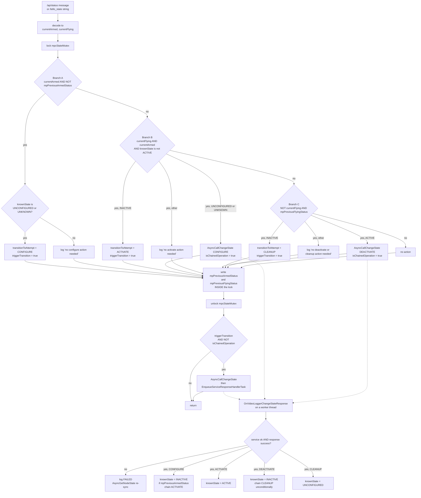

# SLAM lifecycle driven by `/ap/status` — target-state reconciler + transition-event observer

**Status:** IMPLEMENTED 2026-07-27. Container-side validation outstanding, catalogued in §8.
**Scope of the change:** `ros_ws/src/controllers/controllers/slam/driver_node.py`, `mono_driver_node.py`, `basalt_driver_node.py`, both controller entry-point scripts, `ros_ws/src/slam/src/basalt/node.cpp`, `ros_ws/src/slam/src/orbslam3/monocular.cpp`, `ros_ws/src/controllers/src/logging/video_controller.cpp` and `ros_ws/src/controllers/include/controllers/logging/video_controller.h`.
**Read-only investigation also covered:** `ros_ws/src/controllers/src/common/controller.cpp`, `ros_ws/src/slam/include/slam/node.hpp`, `ros_ws/src/sensors/src/video/logger.cpp`, and `ardu_ws/src/ardupilot` (AP_DDS, ArduCopter).

---

## 1. Motivation

The requested behaviour is a straight mapping from autopilot flight phase to SLAM lifecycle state.

| ArduPilot phase | SLAM compute node must be |
|---|---|
| unarmed (before the flight) | `UNCONFIGURED` |
| armed, not yet airborne | `INACTIVE` (i.e. configured) |
| flying | `ACTIVE` |
| landed and disarmed | deactivated, then cleaned up → back to `UNCONFIGURED`, ready for the next cycle |

`SLAMDriverNode._ap_status_callback` did not implement this, and, more seriously, the mechanism it was built on could not work at all under the executor the node actually ran with. Four defects are established in §3. The change replaces the callback's ad-hoc edge/branch logic with a target-state reconciler, and replaces the blocking per-message `get_state` service round-trip with a push-based state mirror fed by the compute node's `transition_event` topic, which is also, and not coincidentally, exactly the subscriber needed for per-transition logging. One subscriber discharges both requirements.

The same reconciler shape was then applied, behaviour-preserving, to the C++ video logging controller in §6, so that both lifecycle managers in this workspace are read the same way.

---

## 2. What `/ap/status` actually reports (evidence)

### 2.1 Message definition

`ardupilot_msgs/msg/Status` — `ardu_ws/src/ardupilot/Tools/ros2/ardupilot_msgs/msg/Status.msg`:

```
std_msgs/Header header
uint8 vehicle_type      # From AP_Vehicle_Type.h; constants APM_ROVER=1 … APM_HELI=13
bool  armed             # true if vehicle is armed
uint8 mode              # Vehicle mode, enum depending on vehicle type
bool  flying            # True if flying/driving/diving/tracking
bool  external_control  # True if external control is enabled
uint8[] failsafe        # Active failsafes; FS_RADIO=21 FS_BATTERY=22 FS_GCS=23 FS_EKF=24
```

### 2.2 How each field is populated

`AP_DDS_Client::update_topic(ardupilot_msgs_msg_Status&)` — `ardu_ws/src/ardupilot/libraries/AP_DDS/AP_DDS_Client.cpp:732-788`:

| Field | Source | Meaning for our purposes |
|---|---|---|
| `header.stamp` | `/clock` if subscribed, else `AP::rtc().get_utc_usec()`, else boot time (`AP_DDS_Client.cpp:214`) | Used only for log correlation here. |
| `header.frame_id` | **never assigned** | Always empty, as seen in the capture. Do not key on it. |
| `vehicle_type` | `AP::fwversion().vehicle_type` | Build type, **not** `MAV_TYPE`, a compile-time constant from `APM_BUILD_DIRECTORY` (`libraries/AP_Common/AP_FWVersionDefine.h:42-48`). **`2` = `APM_BUILD_ArduCopter`** (`libraries/AP_Vehicle/AP_Vehicle_Type.h:24`). The coincidence that `MAV_TYPE_QUADROTOR` is also `2` makes this an easy and silent misread, and traditional heli is a separate value, `13`. |
| `armed` | `hal.util->get_soft_armed()` | Motors soft-armed (HAL flag, not `AP::arming().is_armed()`). The authoritative "a flight is in progress" flag. |
| `mode` | `vehicle->get_mode()` | **Per-vehicle-type enum** (pure virtual, `AP_Vehicle.h:129`). Copter's numbering is `ArduCopter/mode.h`, `enum class Mode::Number : uint8_t`. Numbers collide across vehicles, `4` is Copter GUIDED but Plane ACRO and Rover HOLD, so `mode` may never be interpreted without first checking `vehicle_type`. |
| `flying` | `vehicle->get_likely_flying()` | See §2.4. For Copter this is `!ap.land_complete`. The header itself says "Not guaranteed to be accurate" (`AP_Vehicle.h:167-169`). |
| `external_control` | hard-coded `true` | `// Always true for now. To be filled after PR#28429.` **Carries zero information today**, and will silently start carrying information when that PR lands. Nothing may be gated on it. |
| `failsafe` | `rc().in_rc_failsafe()`, `battery.has_failsafed()`, `AP_Notify::flags.failsafe_gcs`, `AP_Notify::flags.failsafe_ekf` | Variable-length **list of active failsafe ids** (`21 FS_RADIO`, `22 FS_BATTERY`, `23 FS_GCS`, `24 FS_EKF`), not a bitmask and not fixed-index. Empty in the captured log. Note `FS_BATTERY` **latches**, `AP_BattMonitor::has_failsafed()` returns whether a battery failsafe has ever triggered this boot, so it never clears. The other three are live. |

### 2.3 Copter mode numbers seen in the capture

From `ardu_ws/src/ardupilot/ArduCopter/mode.h` (`enum class Number : uint8_t`): `0 STABILIZE`, `1 ACRO`, `2 ALT_HOLD`, `3 AUTO`, **`4 GUIDED`**, `5 LOITER`, `6 RTL`, `7 CIRCLE`, **`9 LAND`**, `11 DRIFT`, `13 SPORT`, `14 FLIP`, `15 AUTOTUNE`, `16 POSHOLD`, `17 BRAKE`, `18 THROW`, `19 AVOID_ADSB`, `20 GUIDED_NOGPS`, `21 SMART_RTL`, `22 FLOWHOLD`, `23 FOLLOW`, `24 ZIGZAG`, `25 SYSTEMID`, `26 AUTOROTATE`, `27 AUTO_RTL`, `28 TURTLE`. (`8`, `10`, `12` are unassigned, `30` is reserved for external/Lua control.)

So the capture is a Copter flying GUIDED (mode 4, the mode `/ap/cmd_takeoff` and external control use) and landing in LAND (mode 9).

### 2.4 `flying` semantics, the load-bearing field

`get_likely_flying()` returns the `likely_flying` member of `AP_Vehicle` (`libraries/AP_Vehicle/AP_Vehicle.h:167`). For Copter the only writer is `ArduCopter/land_detector.cpp:229`, `set_likely_flying(!b)` where `b` is the argument to `set_land_complete()`. Therefore, on a Copter, `flying == !ap.land_complete`, and `update_land_detector()` (`land_detector.cpp:53-55`) opens with:

```cpp
if (!motors->armed()) {
    // if disarmed, always landed.
    set_land_complete(true);
}
```

Three consequences the design relies on.

1. **`flying ⇒ armed`.** Disarmed always forces `land_complete`, hence `flying == false`. The pair `(armed=false, flying=true)` is unreachable, so the reconciler needs only three input states, not four.
2. **`flying` is early on takeoff and late on landing.** It is cleared (→ `flying=true`) by the flight mode's takeoff logic at throttle-up or takeoff command, not on losing ground contact — `ArduCopter/takeoff.cpp:66,96,177`, `mode_guided.cpp:1014`, `mode_stabilize.cpp:49` and peers. On the way down it stays `true` through the entire descent and only clears after the land detector holds its conditions continuously for `LAND_DETECTOR_TRIGGER_SEC = 1.0 s` (`ArduCopter/config.h:355`), or `LAND_AIRMODE_DETECTOR_TRIGGER_SEC = 3.0 s` in a manual-throttle mode with airmode enabled (`config.h:358`). So `flying` reads as "spooled up and committed to fly" rather than "airborne", and it de-asserts one to three seconds after touchdown. Good for our purpose, SLAM is activated slightly before the vehicle leaves the ground and is not torn down early, but it means `flying` must not be used as an edge-accurate airborne/landed signal. Anything needing true ground contact must fuse it with altitude from `/ap/pose/filtered`.
3. **`flying` is a heuristic, not ground truth.** It is derived from throttle-at-lower-limit, throttle-mix-at-min, attitude-error and the confirmation counter above, and the detector deliberately ignores baro, EKF vertical velocity, earth-frame angle, gyro and rangefinder as unreliable near ground (`land_detector.cpp:38-44`). It can false-positive during an aggressive descent. This is why the design refuses to tear SLAM down on a falling `flying` edge while the vehicle is still armed (§4.2, rule R3).

### 2.5 Publication cadence and QoS

- `AP_DDS_Client.cpp:1967` gates status evaluation to once per `DELAY_STATUS_TOPIC_MS = 100 ms` (`AP_DDS_config.h:110`), so 10 Hz is the ceiling.
- `update_topic` publishes immediately on any change to `flying`/`armed`/`mode`/`vehicle_type`/`failsafe_size`/`external_control` (`:761-777`), and otherwise republishes as a keep-alive when `> DELAY_STATUS_TOPIC_MS * 5`, that is at 2 Hz (`:780-783`). Unlike most AP_DDS topics, which publish unconditionally at a fixed period, `/ap/status` is change-driven with a 2 Hz floor, so `ros2 topic hz /ap/status` reads 2 Hz at rest and bursts to 10 Hz across transitions.
- **Gotcha.** The change test compares `failsafe_size`, not the failsafe contents (`:766`). A same-length swap, a radio failsafe clearing at the instant a battery failsafe sets, is invisible until the next 2 Hz keep-alive. Irrelevant to this change, which ignores `failsafe`, but relevant to anything that later acts on it (§9).
- QoS offered, `TRANSIENT_LOCAL`, `RELIABLE`, `KEEP_LAST(1)` — `AP_DDS_Topic_Table.h:339-356`. Only 3 of the 19 topics in that table are `TRANSIENT_LOCAL`.
- **Topic name.** `/ap/status` is the default. With the `DDS_USE_NS` parameter set the topic becomes `/ap/v<MAV_SYSID>/status` (`AP_DDS_Client.cpp:180-186`). The driver's existing `ardupilot_status_topic` parameter already covers this, which is why that parameter exists.

Both cadences are visible in the capture, steady state ticks at 0.510 s and edges arrive 0.102 s apart. **Every state edge is published, nothing is missed by sampling at 2 Hz**, which is what makes a per-message reconciler sufficient and edge-memory unnecessary.

The driver's subscription is `BEST_EFFORT`/`VOLATILE`/depth 1. Per `ros_ws/context/ros-qos-compatibility.md` (rules 1 and 2) this is the weakest possible request, matches AP_DDS, bag replay and hand-rolled test publishers alike, and was deliberately left unchanged. It forgoes the latched sample on late join and picks up the next 2 Hz tick instead, at most 0.5 s of blindness at startup.

### 2.6 The captured cycle, annotated

Epoch 1785054xxx, `Δ` is seconds from the previous sample. `E` marks a change-triggered publish, `·` a 2 Hz keep-alive.

| t | Δ | | armed | mode | flying | Phase |
|---|---|---|---|---|---|---|
| 056.770 … 057.790 | 0.510 | · | T | 4 GUIDED | T | Tail of a previous flight (first `echo`, interrupted) |
| 152.754 … 161.934 | 0.510 | · | F | 9 LAND | F | **Idle on the ground.** Disarmed, mode still LAND from the previous flight's auto-land. 19 identical keep-alives. |
| 162.036 | 0.102 | E | F | **4 GUIDED** | F | Mode switch to GUIDED, still disarmed. Mode edges publish independently of arm edges. |
| 162.138 | 0.102 | E | **T** | 4 | F | **ARM edge.** |
| 162.648 … 165.708 | 0.510 | · | T | 4 | F | **Armed, on the ground, 3.87 s.** Spool-up and pre-takeoff. |
| 166.014 | 0.306 | E | T | 4 | **T** | **TAKEOFF edge**, the land detector clears `land_complete`. |
| 166.524 … 171.624 | 0.510 | · | T | 4 | T | Climb and flight in GUIDED. |
| 171.828 | 0.204 | E | T | **9 LAND** | T | **LAND commanded** while airborne. |
| 172.338 … 194.779 | 0.510 | · | T | 9 | T | **Descent, 23.5 s.** |
| 195.289 | 0.510 | E | T | 9 | **F** | **LAND DETECTED**, `land_complete` set. Per §2.4.2 the wheels were actually down about 1 s earlier. Still armed. |
| 195.799 | 0.510 | E | **F** | 9 | F | **DISARM** (auto-disarm), 0.51 s after touchdown. |
| 196.309 … 199.369 | 0.510 | · | F | 9 | F | Idle on the ground again, identical to the opening block. Cycle closed. |

Readings that drove the design.

- The `armed && !flying` window on the way up is 3.87 s here, ample for a CONFIGURE, but it is not contractually guaranteed to be long. It is however guaranteed to be published, because the arm edge always emits a message.
- The same `armed && !flying` predicate also holds on the way down, for 0.51 s between touchdown and disarm. A stateless predicate-to-state map would therefore DEACTIVATE at touchdown. Teardown must happen on disarm, hence rule R3 in §4.2.
- `mode` changes independently of arm and fly state and is not needed for lifecycle control. It is valuable as log context only.
- The old code's first branch, `msg.armed and not msg.flying`, was entered on both the ascending and the descending pass. It only ever acted when the node was `UNCONFIGURED`, so the descending pass was a silent no-op. That was accidental, not designed.

---

## 3. The defects that forced the design

### 3.1 DEFECT A (blocking) — `_get_state`/`_change_state` re-entered the global executor from inside a callback

`_get_state` and `_change_state` both called `rclpy.spin_until_future_complete(self, future)`, and both were called from inside `_ap_status_callback` and `_tello_status_callback`, which are themselves executed by an executor.

The entry points spun single-threaded, `rclpy.init(); …; rclpy.spin(driver)`. In `rclpy` (Humble) **both** `rclpy.spin(node)` and `rclpy.spin_until_future_complete(node, future)` default to `get_global_executor()`, the same singleton, and `spin_until_future_complete` ends with `finally: executor.remove_node(node)`. Called from within a callback of the outer `rclpy.spin`, it therefore **removed the driver node from the executor that was currently spinning it**. The outer loop kept calling `spin_once()` on an executor with no nodes, and no further `/ap/status` callback ever fired.

Corollaries, independent of the exact `rclpy` internals and each independently disqualifying.

- Re-entrant spinning of the same executor from inside one of its own callbacks is unsupported in `rclpy`, single- or multi-threaded. Moving to a `MultiThreadedExecutor` (Change 5.8) would not have rescued the old code, it would merely have converted a deterministic wedge into a nondeterministic one.
- `_change_state` passed no timeout. `rclpy.spin_until_future_complete(self, future)` with `timeout_sec=None` blocks forever if the response is never delivered, which is precisely the situation created by the point above. There was no recovery path.
- The constructor's `self._get_state()` was **not** affected, because it ran before `rclpy.spin` had added the node, so it added, spun and removed cleanly. This is why the handshake log line worked and hid the problem.

The workspace had already met and solved this exact class of problem on the C++ side. `VideoLoggingDriver`'s constructor `get_state` had to be moved to a zero-delay one-shot timer because a service response cannot be delivered while the executor is not yet spinning the node, and the whole of `video_controller.cpp` is written with async dispatch plus response handlers for the same reason. Async is the established pattern in this workspace, and the Python driver was the outlier.

### 3.2 DEFECT B (behavioural) — the branch logic did not implement the requested lifecycle

Taking the old callback at face value, that is ignoring Defect A.

- `armed && !flying` → configure **only** from `UNCONFIGURED`. Never activated, never chained. Correct for the requested specification on the ascending pass, by luck.
- `armed && flying` → activate **only** from `INACTIVE`. If a status message was missed and the node was still `UNCONFIGURED` when `flying` first arrived, it was stuck, because this branch never configured. The vehicle flew with no SLAM and no error was logged.
- `else` (that is `!armed`) → deactivate and cleanup **only** from `ACTIVE`. A commented-out `elif` showed the `INACTIVE → CLEANUP` case had been noticed and then disabled. So arm then disarm without ever taking off left the node `INACTIVE` forever, and the next arm cycle's CONFIGURE was rejected as an invalid transition. This is the same asymmetry recorded for the C++ logger, in the opposite direction.
- Every branch re-read state with a blocking service call per status message, at 2 Hz or more, forever, including the roughly 19 consecutive identical idle-on-the-ground messages in §2.6 where nothing can possibly need to happen.

### 3.3 DEFECT C (diagnostics) — transition outcomes were invisible

`_change_state` logged `Transition '{transition_id}' failed.`, a bare integer, with no transition name, no state context and no distinction between rejected as invalid for the current state (the service returns `success=false` and no state change occurred) and the callback ran and returned FAILURE or ERROR (the state machine moved to `ErrorProcessing` or back). `BasaltSLAMNode::on_configure` has a real, reachable failure path, `slam_type=VISLAM` with an empty `imu_topic_name` returns `CallbackReturn::FAILURE` (`slam/src/basalt/node.cpp:70-75`), and that surfaced to the operator as `Transition '1' failed.`

### 3.4 DEFECT D (constructor blocking) — the driver was unreachable by its executor while it waited

The constructor held two unbounded `wait_for_service` loops and then a blocking `_get_state()`. Until all three completed the node object did not exist for `main()`, so it could not be added to an executor, so nothing else in the process could make progress and the node was invisible to `ros2 node list`, to parameter queries and to every other client on the graph.

This is the same failure shape as `VideoLoggingDriver`'s original constructor `get_state`, and it is now a standing workspace rule recorded in `ros_ws/context/slam-lifecycle-flow.md`.

> No blocking call may be placed in a node constructor, especially a controller node's. The node must be available to its executor immediately upon construction. Any call that can block belongs in a timer that cancels itself once it has succeeded.

Change 5.3 moves all three into one self-cancelling timer.

---

## 4. Design

Two ideas, and the second one pays for the first.

### 4.1 Idea 1, a target-state reconciler rather than an edge machine

Stop asking "what edge just happened?" and ask "where should the SLAM node be, and what single transition moves it one step closer?" The callback becomes:

```
desired = f(armed, flying, current)          # pure function, §4.2
step    = STEP[(current, desired)]           # one transition, §4.3
dispatch(step)                               # async; on completion, re-run
```

Why this is the right shape here.

- `/ap/status` publishes every edge and keep-alives at 2 Hz (§2.5). A level-triggered reconciler therefore loses nothing an edge detector would catch, and additionally self-heals, so a driver started mid-flight, or one that missed a message, converges on the next tick. The old code could not.
- No `previous_armed` or `previous_flying` members. Those are exactly the state that produced the known teardown gap in the C++ logger and the latent data races beside it. Not introducing them is the cheapest possible fix for a whole bug class.
- Idempotent. Re-running it on an unchanged message is a no-op that logs nothing, so the 19 idle messages in §2.6 cost one dict lookup each.
- It is a strictly smaller piece of code than the branch tree it replaced.

### 4.2 The desired-state function

```
R1.  not armed                                  → UNCONFIGURED
R2.  armed and flying                           → ACTIVE
R3.  armed and not flying and current is ACTIVE → ACTIVE   (hold)
R4.  armed and not flying                       → INACTIVE
R5.  not armed and not flying                   → UNCONFIGURED
```

R1, R2, R4 and R5 are the specification transcribed. **R3 is the one judgement call and it is deliberate.** Without it, the 0.51 s `armed && !flying` window between land-detection and disarm (§2.6, t=195.289) would demote the node to `INACTIVE` half a second before the disarm that is meant to trigger teardown. R3 makes the lifecycle monotonically non-decreasing while armed, so teardown happens only on disarm. It also guards against a land-detector false positive mid-flight (§2.4, point 3) destroying `BasaltSLAM` and its map on a hard descent, from which the design has no recovery beyond starting SLAM from scratch.

R3 costs nothing in practice on a normal landing. `flying` already de-asserts one to three seconds after physical touchdown (§2.4, point 2), so by the time this window opens SLAM has been looking at a stationary ground scene for a second anyway. R3 buys robustness on the abnormal path, not throughput on the normal one.

#### 4.2.1 Why R5 needs no code of its own

R5 states explicitly that a disarmed and landed vehicle requires the node to be cleaned up, not merely deactivated. It is satisfied by the design with no code beyond what §4.3 contains, for three reasons.

First, R5 is logically implied by R1. §2.4 point 1 establishes `flying ⇒ armed` on Copter, so `not armed` already implies `not flying`, and the predicate of R5 is exactly the predicate of R1. The two rules can never disagree, and R5 can never be reached without R1 having already returned `UNCONFIGURED`. R5 is therefore retained in the rule list as documentation of intent rather than as a separate branch, and `_desired_state` carries a comment saying so. Writing it as a fourth branch would be dead code.

Second, the requirement that the cleanup transition be issued only when the node was previously `INACTIVE` is structural rather than conditional. The only row of `TRANSITION_STEP` whose value is `TRANSITION_CLEANUP` is `(INACTIVE, UNCONFIGURED)`. From `ACTIVE` with a target of `UNCONFIGURED` the table yields `TRANSITION_DEACTIVATE` first, and the reconciler is re-entered only after that transition has been confirmed, at which point the mirror reads `INACTIVE` and the second lookup yields `TRANSITION_CLEANUP`. It is therefore impossible for the driver to dispatch a cleanup from any state other than `INACTIVE`, and impossible for it to skip the deactivation. No explicit `if _known_state == INACTIVE` guard is required, and adding one would duplicate the table.

Third, the transition to cleanup now happens at all, which the pre-existing code did not guarantee. The commented-out `elif` in the old `_ap_status_callback` meant that an arm then disarm without takeoff left the node `INACTIVE` permanently. The `(INACTIVE, UNCONFIGURED)` row closes that gap as a side effect of the table being complete, and validation check 13 in §8 exercises exactly that path.

### 4.3 The step table

Legal single steps in the ROS 2 lifecycle, restricted to the three primary states this driver uses.

| from → to | transition |
|---|---|
| `UNCONFIGURED` → `INACTIVE` | `TRANSITION_CONFIGURE` |
| `UNCONFIGURED` → `ACTIVE` | `TRANSITION_CONFIGURE` (then re-run, `INACTIVE → ACTIVE` follows) |
| `INACTIVE` → `ACTIVE` | `TRANSITION_ACTIVATE` |
| `INACTIVE` → `UNCONFIGURED` | `TRANSITION_CLEANUP` |
| `ACTIVE` → `INACTIVE` | `TRANSITION_DEACTIVATE` |
| `ACTIVE` → `UNCONFIGURED` | `TRANSITION_DEACTIVATE` (then re-run, `INACTIVE → UNCONFIGURED` follows) |

Chains are never spelled out as nested code. The reconciler is simply re-entered when a transition completes and takes the next single step. The longest chain is two hops, so re-entry terminates. This is where Defect B's `INACTIVE`-forever gap disappears for free, because `INACTIVE → UNCONFIGURED` is just another row.

### 4.4 Idea 2, mirror the compute node's state from `transition_event`

An `rclcpp_lifecycle::LifecycleNode` publishes `lifecycle_msgs/msg/TransitionEvent` on `~/transition_event` on every state change, including the intermediate transition states. Subscribing to `/basalt_slam_node/transition_event` therefore gives the driver a push-based, authoritative mirror of the compute node's state, and the driver stops needing a `get_state` service call per status message entirely.

This is the key economy of the whole change. **The subscriber needed as a logging feature is also the mechanism that lets the reconciler be non-blocking.** One subscriber, two requirements, and Defect A's per-message blocking round-trip is deleted rather than repaired.

State is held in `self._known_state`, seeded once by an async `get_state` and updated thereafter by three sources.

The first is every `TransitionEvent` whose `goal_state.id` is a primary state (`UNCONFIGURED`, `INACTIVE`, `ACTIVE`, `FINALIZED`). Transition states (`CONFIGURING` and peers) are logged but do not overwrite the mirror.

The second is the `change_state` response itself, on `success == True`, via a small transition-to-resulting-state table. This is belt and braces against transport ordering. The event travels over a topic and the response over a service, and although `rcl_lifecycle` publishes the event before the service reply is sent, delivery order between two different transports into a multi-threaded executor is not guaranteed. Without it the reconciler could re-enter on the response while the mirror still held the pre-transition state, and dispatch a duplicate. This mirrors what `OnVideoLoggerChangeStateResponse` already does in C++.

The third is a re-sync `get_state` whenever a `change_state` call returns `success=false`, which means the driver's belief about the state was wrong.

**Precedent for the subscription.** `ros_ws/src/sensors/src/video/logger.cpp:291-294` already subscribes to `/video_reader/transition_event` with a bare depth of 10, that is `RELIABLE`/`VOLATILE`, and works. `rcl_lifecycle` creates the transition-event publisher with `rcl_publisher_get_default_options()`, giving `RELIABLE`/`VOLATILE`/`KEEP_LAST(10)`, so a bare-depth request matches exactly, consistent with rule 2 of `ros_ws/context/ros-qos-compatibility.md`. To be confirmed with `ros2 topic info -v` per §8.

### 4.5 Concurrency model

Both SLAM controller entry points moved from `rclpy.spin` (a `SingleThreadedExecutor`) to a `MultiThreadedExecutor` in Change 5.8. That changes the correctness argument for everything above, so the model is stated here once.

Under a `MultiThreadedExecutor`, callbacks in different callback groups may execute concurrently on different threads. The driver has three sources of callbacks and they land in two groups.

| Callback | Group | Can run concurrently with |
|---|---|---|
| `_ap_status_callback` / `_tello_status_callback` | node default, mutually exclusive | the reentrant group |
| `_transition_event_callback` | `service_callback_group`, reentrant | everything, including itself |
| `change_state` / `get_state` future done-callbacks | `service_callback_group`, reentrant (the clients are created there) | everything |
| `_service_ready_timer` | `service_callback_group`, reentrant | everything |

The status subscription stays in the node's default mutually exclusive group, so two status messages can never be processed at once and the armed/flying pair can never be torn. The lifecycle observation path goes in the reentrant group so a transition event is never queued behind a status callback, which is what keeps the mirror fresh.

Every piece of cross-thread state is guarded by one lock, `self._state_lock`, a `threading.RLock`. One lock rather than several, for the reason already recorded for the C++ controller in `video_controller.h`, these variables are always consulted together, a reconciliation is a single read-decide-write over all of them, and splitting them buys no concurrency because the same callbacks read all of them.

| Variable | Written by | Read by |
|---|---|---|
| `_known_state` | `_transition_event_callback`, `_on_change_state_response`, `_on_get_state_response` | `_reconcile`, `_desired_state`, dispatch logging |
| `_transition_in_flight` | `_reconcile` (claim), `_on_change_state_response` (release), `_reconcile` (watchdog release) | `_reconcile` |
| `_transition_deadline` | `_reconcile` (claim) | `_reconcile` (watchdog) |
| `_last_armed`, `_last_flying` | `_ap_status_callback`, `_tello_status_callback` | `_desired_state`, `_phase_description` |

Two rules make the locking correct and are stated in the code as comments.

The claim of `_transition_in_flight` happens inside the same critical section that reads `_known_state` and computes the step. This is the read-decide-write that must not be split, and it is the lesson the flag-ordering comment in `video_controller.cpp` records, that releasing the lock between the read and the write lets a second concurrent callback observe the same stale value and dispatch a duplicate.

The service call itself is dispatched outside the lock. Nothing after the claim reads guarded state, and holding a lock across `call_async` would serialise the reentrant group behind the status callback for no benefit. `RLock` rather than `Lock`, because a future that is already complete can have its done-callback invoked inline on the calling thread by `rclpy`, and the reentrant variant makes that harmless instead of a self-deadlock.

One piece of state is deliberately not guarded, `self._service_ready_timer`, because it is created in the constructor before the node is spun and thereafter only ever touched from its own callback, which cannot re-enter itself.

---

## 5. Changes to the SLAM lifecycle

Changes 5.1 to 5.7 are in `ros_ws/src/controllers/controllers/slam/driver_node.py`. Change 5.8 is in the two entry-point scripts and the two subclass modules. Changes 5.9 and 5.10 are in the `slam` package.

### Change 5.1 — Lifecycle constant tables (module level)

**What.** Lookup tables above the class.

```python
STATE_NAMES = {
    State.PRIMARY_STATE_UNKNOWN: "UNKNOWN",
    State.PRIMARY_STATE_UNCONFIGURED: "UNCONFIGURED",
    State.PRIMARY_STATE_INACTIVE: "INACTIVE",
    State.PRIMARY_STATE_ACTIVE: "ACTIVE",
    State.PRIMARY_STATE_FINALIZED: "FINALIZED",
    State.TRANSITION_STATE_CONFIGURING: "CONFIGURING",
    State.TRANSITION_STATE_CLEANINGUP: "CLEANINGUP",
    State.TRANSITION_STATE_SHUTTINGDOWN: "SHUTTINGDOWN",
    State.TRANSITION_STATE_ACTIVATING: "ACTIVATING",
    State.TRANSITION_STATE_DEACTIVATING: "DEACTIVATING",
    State.TRANSITION_STATE_ERRORPROCESSING: "ERRORPROCESSING",
}

PRIMARY_STATES = frozenset(
    (
        State.PRIMARY_STATE_UNCONFIGURED,
        State.PRIMARY_STATE_INACTIVE,
        State.PRIMARY_STATE_ACTIVE,
        State.PRIMARY_STATE_FINALIZED,
    )
)

TRANSITION_NAMES = {
    Transition.TRANSITION_CONFIGURE: "CONFIGURE",
    Transition.TRANSITION_CLEANUP: "CLEANUP",
    Transition.TRANSITION_ACTIVATE: "ACTIVATE",
    Transition.TRANSITION_DEACTIVATE: "DEACTIVATE",
    Transition.TRANSITION_UNCONFIGURED_SHUTDOWN: "SHUTDOWN(unconfigured)",
    Transition.TRANSITION_INACTIVE_SHUTDOWN: "SHUTDOWN(inactive)",
    Transition.TRANSITION_ACTIVE_SHUTDOWN: "SHUTDOWN(active)",
}

# (current_state, desired_state) -> the single transition that steps toward it.
# The only CLEANUP row is (INACTIVE, UNCONFIGURED), which is what structurally
# guarantees rule R5: cleanup is never dispatched from any other state, and the
# ACTIVE -> UNCONFIGURED teardown must pass through DEACTIVATE first.
TRANSITION_STEP = {
    (
        State.PRIMARY_STATE_UNCONFIGURED,
        State.PRIMARY_STATE_INACTIVE,
    ): Transition.TRANSITION_CONFIGURE,
    (
        State.PRIMARY_STATE_UNCONFIGURED,
        State.PRIMARY_STATE_ACTIVE,
    ): Transition.TRANSITION_CONFIGURE,
    (
        State.PRIMARY_STATE_INACTIVE,
        State.PRIMARY_STATE_ACTIVE,
    ): Transition.TRANSITION_ACTIVATE,
    (
        State.PRIMARY_STATE_INACTIVE,
        State.PRIMARY_STATE_UNCONFIGURED,
    ): Transition.TRANSITION_CLEANUP,
    (
        State.PRIMARY_STATE_ACTIVE,
        State.PRIMARY_STATE_INACTIVE,
    ): Transition.TRANSITION_DEACTIVATE,
    (
        State.PRIMARY_STATE_ACTIVE,
        State.PRIMARY_STATE_UNCONFIGURED,
    ): Transition.TRANSITION_DEACTIVATE,
}

# The state the compute node is in once a transition has been confirmed
# successful by the change_state response. Used only as a same-instant fallback
# for the transition_event mirror.
TRANSITION_RESULT_STATE = {
    Transition.TRANSITION_CONFIGURE: State.PRIMARY_STATE_INACTIVE,
    Transition.TRANSITION_ACTIVATE: State.PRIMARY_STATE_ACTIVE,
    Transition.TRANSITION_DEACTIVATE: State.PRIMARY_STATE_INACTIVE,
    Transition.TRANSITION_CLEANUP: State.PRIMARY_STATE_UNCONFIGURED,
}

# A dispatched transition that has neither succeeded nor failed within this many
# seconds is assumed lost, so the reconciler unwedges itself and retries. The old
# _change_state passed no timeout at all and would block forever.
TRANSITION_TIMEOUT_SEC = 10.0

# How often to poll for the compute node's lifecycle services during startup.
SERVICE_POLL_PERIOD_SEC = 1.0
```

**Need.** Every log line in Change 5.6 names states and transitions instead of printing integers (Defect C). Using the `lifecycle_msgs` constants rather than literals means the tables cannot drift from the ROS distribution.

**Backwards compatibility.** Additive, module-private, no import changes beyond what `driver_node.py` already imported (`State`, `Transition`) plus `TransitionEvent` and `threading`. Nothing outside the module can see them.

### Change 5.2 — Copter mode names for log context

**What.** A module-level `COPTER_MODE_NAMES` transcribed from `ArduCopter/mode.h` (§2.3), and a helper.

```python
def _mode_name(vehicle_type: int, mode: int) -> str:
    """Human-readable flight mode. Only Copter's enum is transcribed; every other
    vehicle type numbers its modes differently (Status.msg: 'enum depending on
    vehicle type'), so anything else is reported as a bare number."""
    if vehicle_type == Status.APM_ARDUCOPTER:
        return COPTER_MODE_NAMES.get(mode, f"mode {mode}")
    return f"mode {mode}"
```

**Need.** Purely diagnostic. §2.6 shows mode edges arriving as their own status messages, and being able to read `GUIDED → LAND` in the driver log is what lets an operator correlate a SLAM transition with what the vehicle was doing. `mode` is never used for control.

**Significance.** `Status.APM_ARDUCOPTER` is a generated message constant (verified present in `ardupilot_msgs/msg/Status.msg`), so the guard is exact, and a Plane or Rover deployment degrades to `mode 4` rather than mislabelling it `GUIDED`.

**Backwards compatibility.** Additive. No behavioural coupling.

### Change 5.3 — A non-blocking constructor, the service-readiness timer, and the state mirror

**What.** The constructor keeps everything it did up to and including the creation of the two lifecycle clients, and then stops blocking. The two `wait_for_service` loops and the blocking `_get_state()` are replaced by state initialisation, the `transition_event` subscription, and one repeating timer that cancels itself once the handshake has completed.

```python
        # Every variable below is read and written from more than one executor
        # thread, so all of them are guarded by _state_lock. One lock rather than
        # several: they are always consulted together, a reconciliation is a
        # single read-decide-write over all of them, and the same callbacks read
        # all of them, so splitting would buy no concurrency.
        self._state_lock = threading.RLock()
        self._known_state = State.PRIMARY_STATE_UNKNOWN
        self._transition_in_flight = False
        self._transition_deadline = 0.0
        self._last_armed = False
        self._last_flying = False

        transition_event_topic = f"/{self.slam_compute_node_name}/transition_event"
        self.transition_event_subscriber = self.create_subscription(
            TransitionEvent,
            transition_event_topic,
            self._transition_event_callback,
            10,
            callback_group=self.service_callback_group,
        )
        self.get_logger().info(
            f"Observing lifecycle transitions of '{self.slam_compute_node_name}' "
            f"on '{transition_event_topic}'"
        )

        # Nothing that can block belongs in this constructor. main() adds the node
        # to its executor only after construction returns, so a service response
        # cannot be delivered here, and until the constructor returns the node is
        # invisible to the executor and to the rest of the graph. The service
        # handshake and the initial state query therefore run from a timer that
        # cancels itself once it has succeeded. See
        # ros_ws/context/slam-lifecycle-flow.md, "No blocking calls in a node
        # constructor".
        self._service_ready_timer = self.create_timer(
            SERVICE_POLL_PERIOD_SEC,
            self._await_lifecycle_services,
            callback_group=self.service_callback_group,
        )
```

The status subscription block is unchanged and stays in the constructor, so no status message can be missed between construction and the first spin. This mirrors the reason `SetupROSInterfaces()` stays in `VideoLoggingDriver`'s constructor. It gained one comment recording that it deliberately stays in the node's default mutually exclusive callback group.

The handshake and the state query.

```python
    def _await_lifecycle_services(self) -> None:
        """Poll for the compute node's lifecycle services, then seed the state mirror.

        Runs on a repeating timer rather than in the constructor so the node is
        available to its executor immediately. `service_is_ready()` is a
        non-blocking graph query, unlike `wait_for_service()`, so this callback
        never occupies its executor thread for longer than the query itself.
        """
        change_ready = self.change_state_client.service_is_ready()
        get_ready = self.get_state_client.service_is_ready()
        if not (change_ready and get_ready):
            self.get_logger().info(
                f"Waiting for the lifecycle services of '{self.slam_compute_node_name}', "
                f"change_state={'up' if change_ready else 'down'}, "
                f"get_state={'up' if get_ready else 'down'}",
                throttle_duration_sec=10.0,
            )
            return

        self._service_ready_timer.cancel()
        self.get_logger().info(
            f"Lifecycle services of '{self.slam_compute_node_name}' are available, "
            f"querying its initial state"
        )
        self._query_state("initial_handshake", reconcile_after=True)

    def _query_state(self, context: str, reconcile_after: bool) -> None:
        """Ask the compute node for its current state and refresh the mirror.

        `reconcile_after` is False on the re-sync issued after a rejected or
        failed transition. Reconciling there would retry the failed transition
        the instant the answer arrived, which turns a persistent fault such as a
        VISLAM configuration error into a service call storm. The next
        `/ap/status` message retries it instead, which rate-limits recovery to
        the autopilot's 2 Hz keep-alive.
        """
        future = self.get_state_client.call_async(GetState.Request())
        future.add_done_callback(
            lambda fut, ctx=context, rec=reconcile_after: self._on_get_state_response(
                fut, ctx, rec
            )
        )

    def _on_get_state_response(self, future, context: str, reconcile_after: bool) -> None:
        """Store the queried state in the mirror, and optionally take the next step."""
        exception = future.exception()
        if exception is not None or future.result() is None:
            self.get_logger().error(
                f"get_state on '{self.slam_compute_node_name}' failed during '{context}', "
                f"{exception}. The lifecycle mirror is stale and will be refreshed on the "
                f"next transition or the next failed request."
            )
            return

        state_id = future.result().current_state.id
        with self._state_lock:
            self._known_state = state_id
        self.get_logger().info(
            f"'{self.slam_compute_node_name}' reports state "
            f"{STATE_NAMES.get(state_id, state_id)} ({context})"
        )
        if reconcile_after:
            self._reconcile()
```

New imports, `import threading` and `TransitionEvent` added to the `lifecycle_msgs.msg` import.

**Intuition.** The driver used to pull state, synchronously, once per status message. Now it is told the state, once per actual change. At 2 Hz status over the 47 s cycle of §2.6 that is roughly 94 service round-trips replaced by about 6 pushed events.

**Backwards compatibility.** This is the largest behavioural change in the plan and it has three parts.

The constructor no longer blocks. `SLAMDriverNode.__init__` now returns in bounded time whether or not the compute node exists. Both subclasses call `super().__init__(node_name)` first and then only declare their own parameters, neither reads any attribute this change touches and neither overrides any method involved, so both are unaffected.

The constructor no longer guarantees the lifecycle services exist by the time it returns. Previously the launch graph's 3 s `TimerAction` delay before the controller starts (`controllers/launch/basalt_slam_test.launch.py:135-137`) plus the `wait_for_service` loops made the ordering deterministic. Now the ordering is enforced instead by the reconciler's `_known_state == UNKNOWN` early return, which holds until the initial `get_state` lands. The launch delay is left in place and remains harmless. The observable difference is that a driver launched against a missing compute node now logs a throttled waiting line every 10 s and stays responsive, instead of blocking silently in the constructor.

The initial state is no longer returned to the constructor. Nothing consumed it, it was logged and discarded, and the equivalent line is now emitted by `_on_get_state_response`.

The `transition_event` subscription is created against a topic name derived from the existing `slam_compute_node_name` parameter, so there is no new parameter and no launch-file change. `basalt_slam.launch.py:64-69` puts the compute node at name `basalt_slam_node` in namespace `/`, so the topic resolves to `/basalt_slam_node/transition_event`.

### Change 5.4 — Async transition dispatch and its response handler

**What.** Two methods replace the body of `_change_state`. The claim of `_transition_in_flight` is made by `_reconcile` under the lock (§4.5), so `_request_transition` is purely the dispatch half and takes the believed state as an argument rather than re-reading it, which would require re-taking the lock and could read a value the decision was not made against.

```python
    def _request_transition(
        self, transition_id: int, believed_state: int, reason: str
    ) -> None:
        """Dispatch one lifecycle transition without blocking the executor.

        The caller must already have claimed `_transition_in_flight` under
        `_state_lock`. This method deliberately performs no service call while
        holding that lock, so a slow round-trip cannot serialise the callback
        groups behind it.
        """
        request = ChangeState.Request()
        request.transition.id = transition_id
        name = TRANSITION_NAMES.get(transition_id, f"transition {transition_id}")
        self.get_logger().info(
            f"Requesting {name} on '{self.slam_compute_node_name}' from "
            f"{STATE_NAMES.get(believed_state, believed_state)}, {reason}"
        )
        future = self.change_state_client.call_async(request)
        future.add_done_callback(
            lambda fut, tid=transition_id: self._on_change_state_response(fut, tid)
        )

    def _on_change_state_response(self, future, transition_id: int) -> None:
        """Handle the change_state reply, release the in-flight guard, take the next step."""
        name = TRANSITION_NAMES.get(transition_id, f"transition {transition_id}")
        with self._state_lock:
            self._transition_in_flight = False
            believed_state = self._known_state

        exception = future.exception()
        if exception is not None or future.result() is None:
            self.get_logger().error(
                f"{name} on '{self.slam_compute_node_name}' raised {exception}. Lifecycle "
                f"control is degraded and SLAM may no longer track the vehicle. "
                f"Re-synchronising the state mirror."
            )
            self._query_state(f"after_{name}_exception", reconcile_after=False)
            return

        if not future.result().success:
            self.get_logger().warn(
                f"{name} was REJECTED by '{self.slam_compute_node_name}'. The driver believed "
                f"the node was {STATE_NAMES.get(believed_state, believed_state)}, but the "
                f"lifecycle state machine does not permit {name} from the node's actual state. "
                f"No transition_event is published for a rejected request, so this line is the "
                f"only record of it. Re-synchronising."
            )
            self._query_state(f"after_{name}_rejected", reconcile_after=False)
            return

        # Belt and braces against transport ordering. The transition_event
        # travels over a topic and this response over a service, and delivery
        # order between two transports into a multi-threaded executor is not
        # guaranteed. The authoritative, human-readable outcome log comes from
        # the transition_event observer, so this path stays at debug.
        with self._state_lock:
            self._known_state = TRANSITION_RESULT_STATE.get(
                transition_id, self._known_state
            )
        self.get_logger().debug(f"{name} accepted by '{self.slam_compute_node_name}'")
        self._reconcile()
```

**Why the rejection path does not reconcile.** A rejected or failed transition that immediately triggers another attempt is a spin loop, and `BasaltSLAMNode::on_configure` has a persistent failure mode that would drive one (`slam_type=VISLAM` with an empty `imu_topic_name`). Recovery is instead paced by the next `/ap/status` message, which is at most 0.5 s away (§2.5). The same rule governs which `transition_event` ids re-enter the reconciler in Change 5.6.

**Why `_transition_in_flight` exists.** It prevents the reconciler dispatching a second transition while one is outstanding. This is the cure for the duplicate-dispatch noise previously documented for the C++ logger, one spurious "Transition Activate FAILED" ERROR line, and doing it correctly costs one boolean and one deadline. The deadline is the watchdog described in Change 5.5, and it exists because the previous implementation could block forever with no recovery path (§3.1).

**Thread safety.** Governed by §4.5. Every access to `_transition_in_flight` and `_known_state` in this method is inside a `with self._state_lock` block, and both service calls are issued outside it.

**Backwards compatibility.** Additive. `_change_state` and `_get_state` are left in place, unmodified in body, so any out-of-tree caller keeps working. The grep in §7.1 shows there are none in this workspace, and after this change nothing in `driver_node.py` calls them either. Their docstrings gained a deprecation note pointing at §3.1, so the deadlock is not reintroduced by a future caller.

### Change 5.5 — `_reconcile`, `_desired_state`, `_phase_description` and the rewritten `_ap_status_callback`

**What.** `_ap_status_callback` shrinks to a record-and-reconcile.

```python
    def _ap_status_callback(self, msg: Status):
        """Drive the SLAM node's lifecycle from ArduPilot's armed/flying state.

        `/ap/status` publishes on every change and keeps alive at 2 Hz
        (AP_DDS_Client.cpp:761-783), so this is level-triggered rather than
        edge-triggered. The callback records where the vehicle is and asks the
        reconciler to take one step toward where SLAM should therefore be, which
        makes it idempotent and self-healing, so a driver started mid-flight
        converges on the next status message.
        """
        with self._state_lock:
            changed = msg.armed != self._last_armed or msg.flying != self._last_flying
            self._last_armed = msg.armed
            self._last_flying = msg.flying

        if changed:
            self.get_logger().info(
                f"ArduPilot armed={msg.armed} flying={msg.flying} "
                f"mode={_mode_name(msg.vehicle_type, msg.mode)}"
                + (f" failsafe={list(msg.failsafe)}" if msg.failsafe else "")
            )
        self._reconcile()
```

The desired-state function, the phase description that feeds the dispatch log, and the reconciler itself.

```python
    def _desired_state(self) -> int:
        """Map the vehicle's phase to the lifecycle state SLAM should be in.

        The caller must hold `_state_lock`.

        ArduCopter forces land_complete (hence flying=False) whenever disarmed
        (ArduCopter/land_detector.cpp:53-55), so (armed=False, flying=True) is
        unreachable and three cases cover the space. Rule R5 of the plan, "not
        armed and not flying implies UNCONFIGURED", is exactly rule R1 under that
        invariant and needs no branch of its own. The cleanup transition R5 calls
        for is supplied by the (INACTIVE, UNCONFIGURED) row of TRANSITION_STEP,
        which is also the only row that can ever emit a CLEANUP.
        """
        if not self._last_armed:
            return State.PRIMARY_STATE_UNCONFIGURED  # R1, and R5
        if self._last_flying:
            return State.PRIMARY_STATE_ACTIVE  # R2
        if self._known_state == State.PRIMARY_STATE_ACTIVE:
            # R3, hold. `flying` is a land *detector* built from throttle and
            # attitude heuristics (ArduCopter/land_detector.cpp), and it drops
            # about 0.5 s before the auto-disarm at touchdown. Tearing SLAM down
            # here would pre-empt the disarm that is meant to trigger teardown,
            # and would let a mid-descent false positive destroy the map. While
            # armed, the lifecycle only ever moves up.
            return State.PRIMARY_STATE_ACTIVE
        return State.PRIMARY_STATE_INACTIVE  # R4

    def _phase_description(self, desired: int) -> str:
        """One human sentence explaining why a transition is being requested.

        The caller must hold `_state_lock`, because this reads the recorded
        vehicle phase. It performs no I/O, so holding the lock across it is free.
        """
        if desired == State.PRIMARY_STATE_ACTIVE:
            if self._last_flying:
                return "the vehicle is FLYING, so SLAM must be ACTIVE"
            return (
                "the vehicle is ARMED on the ground and SLAM is already ACTIVE, so SLAM is "
                "held ACTIVE until disarm (rule R3)"
            )
        if desired == State.PRIMARY_STATE_INACTIVE:
            return (
                "the vehicle is ARMED on the ground, so SLAM must be CONFIGURED and ready "
                "for takeoff"
            )
        if desired == State.PRIMARY_STATE_UNCONFIGURED:
            return (
                "the vehicle is DISARMED, so SLAM must be torn down and cleaned up for the "
                "next cycle"
            )
        return f"the target state is {STATE_NAMES.get(desired, desired)}"

    def _reconcile(self) -> None:
        """Take at most one lifecycle step toward the state the vehicle implies.

        The whole decision, that is read the mirror, compute the target, look up
        the step and claim the in-flight guard, happens inside one critical
        section. Splitting it would let two concurrent callbacks read the same
        mirror and dispatch the same transition twice, which is exactly the race
        video_controller.cpp:319-336 documents. The service call itself is issued
        after the lock is released.
        """
        with self._state_lock:
            if self._transition_in_flight:
                if self.get_clock().now().nanoseconds * 1e-9 < self._transition_deadline:
                    return
                self.get_logger().error(
                    f"A lifecycle transition on '{self.slam_compute_node_name}' has not "
                    f"completed within {TRANSITION_TIMEOUT_SEC:.0f} s. Assuming the response "
                    f"is lost and allowing a retry."
                )
                self._transition_in_flight = False

            known = self._known_state
            if known in (State.PRIMARY_STATE_UNKNOWN, -1):
                return  # initial get_state still pending
            if known == State.PRIMARY_STATE_FINALIZED:
                self.get_logger().error(
                    f"'{self.slam_compute_node_name}' is FINALIZED. A shut-down lifecycle node "
                    f"cannot be restarted, so SLAM is unavailable for the rest of this run. "
                    f"Restart the compute node.",
                    throttle_duration_sec=30.0,
                )
                return

            desired = self._desired_state()
            if desired == known:
                return

            transition = TRANSITION_STEP.get((known, desired))
            if transition is None:
                self.get_logger().warn(
                    f"No single lifecycle step from {STATE_NAMES.get(known, known)} to "
                    f"{STATE_NAMES.get(desired, desired)}, waiting for "
                    f"'{self.slam_compute_node_name}' to settle.",
                    throttle_duration_sec=10.0,
                )
                return

            reason = self._phase_description(desired)
            self._transition_in_flight = True
            self._transition_deadline = (
                self.get_clock().now().nanoseconds * 1e-9 + TRANSITION_TIMEOUT_SEC
            )

        self._request_transition(transition, known, reason)
```

**Why the `_known_state == UNKNOWN` early return is a guard and not a failure path.** It only holds until the initial `get_state` lands, which is milliseconds after the lifecycle services appear. While it holds, status messages are still recorded into `_last_armed` and `_last_flying`, so the moment the state arrives its done-callback calls `_reconcile()` and the driver catches up.

**Walk-through against the real capture (§2.6)**, assuming the node starts `UNCONFIGURED`.

| t | armed/flying | desired | known | action |
|---|---|---|---|---|
| 152.754–161.934 | F/F | UNCONFIGURED | UNCONFIGURED | none, silent |
| 162.036 | F/F (mode edge) | UNCONFIGURED | UNCONFIGURED | none |
| 162.138 | **T**/F | INACTIVE | UNCONFIGURED | **CONFIGURE** |
| ~162.2 | — | — | → INACTIVE | (`transition_event`) |
| 162.648–165.708 | T/F | INACTIVE | INACTIVE | none, silent |
| 166.014 | T/**T** | ACTIVE | INACTIVE | **ACTIVATE** |
| 166.5–194.8 | T/T | ACTIVE | ACTIVE | none, silent (including the mode-9 edge) |
| 195.289 | T/**F** | ACTIVE (R3 holds) | ACTIVE | none |
| 195.799 | **F**/F | UNCONFIGURED | ACTIVE | **DEACTIVATE** → on response, re-enter → **CLEANUP** |
| 196.309+ | F/F | UNCONFIGURED | UNCONFIGURED | none, silent |

Exactly the requested lifecycle, and the next arm edge repeats it.

**Backwards compatibility.** `_ap_status_callback`'s signature, its subscription, its QoS and the `Status` message type are unchanged, only the body changed. No launch file, parameter, topic name or entry-point argument is touched. The `INACTIVE → UNCONFIGURED` row of `TRANSITION_STEP` closes the arm-then-disarm-without-flying gap of Defect B as a side effect, which is a strict improvement over the commented-out `elif` it replaces.

### Change 5.6 — `TransitionEvent` observer with a unique message per outcome

**What.** `_transition_event_callback(self, msg: TransitionEvent)` plus the message table it is driven by.

**The key fact that shapes it.** `rcl_lifecycle`'s default state machine gives result transitions the shared labels `"transition_success"`, `"transition_failure"` and `"transition_error"`, so `msg.transition.label` is **not** unique and cannot be the key. `msg.transition.id` is. The ids come in four families.

| id | constant | meaning |
|---|---|---|
| 0, 8 | `TRANSITION_CREATE`, `TRANSITION_DESTROY` | construction and destruction of the state machine |
| 1,2,3,4,5,6,7 | `TRANSITION_CONFIGURE`, `_CLEANUP`, `_ACTIVATE`, `_DEACTIVATE`, `_UNCONFIGURED_SHUTDOWN`, `_INACTIVE_SHUTDOWN`, `_ACTIVE_SHUTDOWN` | the request, the node enters a transition state |
| 10/11/12, 20/21/22, 30/31/32, 40/41/42, 50/51/52 | `TRANSITION_ON_{CONFIGURE,CLEANUP,ACTIVATE,DEACTIVATE,SHUTDOWN}_{SUCCESS,FAILURE,ERROR}` | the outcome of the corresponding callback |
| 60/61/62 | `TRANSITION_ON_ERROR_{SUCCESS,FAILURE,ERROR}` | the outcome of `on_error` |

The table, in full. `{node}` is substituted with `slam_compute_node_name` at log time, so each message has exactly one definition rather than being an f-string repeated per call site.

```python
# msg.transition.id -> (logger method name, message). Keyed on the id and never
# on msg.transition.label, because rcl_lifecycle reuses the labels
# "transition_success", "transition_failure" and "transition_error" for every
# outcome transition, so the label cannot identify which callback produced it.
TRANSITION_EVENT_LOGS = {
    Transition.TRANSITION_CREATE: (
        "debug",
        "'{node}' created its lifecycle state machine and is UNCONFIGURED.",
    ),
    Transition.TRANSITION_CONFIGURE: (
        "debug",
        "'{node}' is CONFIGURING, on_configure() has been entered.",
    ),
    Transition.TRANSITION_CLEANUP: (
        "debug",
        "'{node}' is CLEANINGUP, on_cleanup() has been entered.",
    ),
    Transition.TRANSITION_ACTIVATE: (
        "debug",
        "'{node}' is ACTIVATING, on_activate() has been entered.",
    ),
    Transition.TRANSITION_DEACTIVATE: (
        "debug",
        "'{node}' is DEACTIVATING, on_deactivate() has been entered.",
    ),
    Transition.TRANSITION_UNCONFIGURED_SHUTDOWN: (
        "warn",
        "'{node}' is SHUTTINGDOWN from UNCONFIGURED. This driver did not request it, so "
        "something else is tearing the SLAM node down.",
    ),
    Transition.TRANSITION_INACTIVE_SHUTDOWN: (
        "warn",
        "'{node}' is SHUTTINGDOWN from INACTIVE. This driver did not request it, so "
        "something else is tearing the SLAM node down.",
    ),
    Transition.TRANSITION_ACTIVE_SHUTDOWN: (
        "warn",
        "'{node}' is SHUTTINGDOWN from ACTIVE, so SLAM is being stopped mid-flight. This "
        "driver did not request it.",
    ),
    Transition.TRANSITION_DESTROY: (
        "error",
        "'{node}' has destroyed its lifecycle state machine. The compute node is gone and "
        "this driver can no longer control SLAM.",
    ),
    Transition.TRANSITION_ON_CONFIGURE_SUCCESS: (
        "info",
        "CONFIGURE succeeded, '{node}' is now INACTIVE. Parameters have been read and "
        "validated, which for Basalt means the camera and IMU topic names and the "
        "calibration and configuration file paths. No SLAM object exists yet and no image "
        "or IMU callbacks are subscribed. Ready to activate on takeoff.",
    ),
    Transition.TRANSITION_ON_CONFIGURE_FAILURE: (
        "error",
        "CONFIGURE FAILED, on_configure() returned FAILURE and '{node}' fell back to "
        "UNCONFIGURED. SLAM will not run this flight. The most likely cause is "
        "slam_type=VISLAM with an empty imu_topic_name (BasaltSLAMNode::on_configure, "
        "slam/src/basalt/node.cpp:70-75). Check the compute node's log and the launch "
        "arguments.",
    ),
    Transition.TRANSITION_ON_CONFIGURE_ERROR: (
        "error",
        "CONFIGURE RAISED, on_configure() threw or returned ERROR and '{node}' is running "
        "on_error(). This is a code fault rather than a configuration problem, so read the "
        "exception in the compute node's log.",
    ),
    Transition.TRANSITION_ON_ACTIVATE_SUCCESS: (
        "info",
        "ACTIVATE succeeded, '{node}' is now ACTIVE. The SLAM back end has been "
        "constructed, the camera and IMU subscriptions and the TF broadcaster are live, "
        "and pose estimates should start appearing on /tf.",
    ),
    Transition.TRANSITION_ON_ACTIVATE_FAILURE: (
        "error",
        "ACTIVATE FAILED, on_activate() returned FAILURE and '{node}' returned to INACTIVE. "
        "The vehicle is flying without SLAM. Check the calibration and configuration file "
        "paths, because the Basalt back end is constructed at activation rather than at "
        "configuration, so a bad path or an unreadable JSON surfaces here.",
    ),
    Transition.TRANSITION_ON_ACTIVATE_ERROR: (
        "error",
        "ACTIVATE RAISED, on_activate() threw and '{node}' is running on_error(). "
        "Historically this path has meant a native fault inside the Basalt back end, so if "
        "the process died rather than transitioned see "
        "ros_ws/context/simd-eigen-abi-mismatch.md.",
    ),
    Transition.TRANSITION_ON_DEACTIVATE_SUCCESS: (
        "info",
        "DEACTIVATE succeeded, '{node}' is INACTIVE. The camera and IMU subscriptions, the "
        "annotated frame publisher, the TF broadcaster and the SLAM object have been "
        "released, so the map from this flight is gone. Awaiting CLEANUP.",
    ),
    Transition.TRANSITION_ON_DEACTIVATE_FAILURE: (
        "error",
        "DEACTIVATE FAILED, on_deactivate() returned FAILURE and '{node}' is still ACTIVE. "
        "It may still hold the SLAM back end and its subscriptions, so the next arm cycle "
        "will be refused. Restart the compute node.",
    ),
    Transition.TRANSITION_ON_DEACTIVATE_ERROR: (
        "error",
        "DEACTIVATE RAISED, on_deactivate() threw and '{node}' is running on_error(). The "
        "SLAM back end was being destroyed when this happened, so treat any subsequent "
        "crash as related.",
    ),
    Transition.TRANSITION_ON_CLEANUP_SUCCESS: (
        "info",
        "CLEANUP succeeded, '{node}' is UNCONFIGURED and ready for the next arm and takeoff "
        "cycle.",
    ),
    Transition.TRANSITION_ON_CLEANUP_FAILURE: (
        "error",
        "CLEANUP FAILED, on_cleanup() returned FAILURE and '{node}' did not return to "
        "UNCONFIGURED, so the next CONFIGURE on arming will be rejected. SLAM is unavailable "
        "until the compute node is restarted.",
    ),
    Transition.TRANSITION_ON_CLEANUP_ERROR: (
        "error",
        "CLEANUP RAISED, on_cleanup() threw and '{node}' is running on_error(). The node is "
        "not reusable for the next flight.",
    ),
    Transition.TRANSITION_ON_SHUTDOWN_SUCCESS: (
        "warn",
        "'{node}' has shut down cleanly and is FINALIZED. A finalized lifecycle node cannot "
        "be restarted, so this driver can no longer control SLAM.",
    ),
    Transition.TRANSITION_ON_SHUTDOWN_FAILURE: (
        "error",
        "SHUTDOWN FAILED, on_shutdown() returned FAILURE on '{node}'. The node is in an "
        "undefined state and must be restarted.",
    ),
    Transition.TRANSITION_ON_SHUTDOWN_ERROR: (
        "error",
        "SHUTDOWN RAISED, on_shutdown() threw on '{node}'. The node is in an undefined state "
        "and must be restarted.",
    ),
    Transition.TRANSITION_ON_ERROR_SUCCESS: (
        "warn",
        "on_error() handled the fault and '{node}' recovered to UNCONFIGURED. This driver "
        "will re-configure it on the next status message.",
    ),
    Transition.TRANSITION_ON_ERROR_FAILURE: (
        "error",
        "on_error() returned FAILURE on '{node}', which is now FINALIZED and unrecoverable.",
    ),
    Transition.TRANSITION_ON_ERROR_ERROR: (
        "error",
        "on_error() itself threw on '{node}', which is now FINALIZED and unrecoverable.",
    ),
}

# Only a successful outcome re-enters the reconciler. Reconciling after a failure
# would retry the failed transition the instant the event arrived, turning a
# persistent fault such as a VISLAM misconfiguration into a service call storm.
# Recovery is paced instead by the next /ap/status message, at most 0.5 s away.
# Same rule as the rejection path in _on_change_state_response.
RECONCILE_AFTER_TRANSITIONS = frozenset(
    (
        Transition.TRANSITION_ON_CONFIGURE_SUCCESS,
        Transition.TRANSITION_ON_CLEANUP_SUCCESS,
        Transition.TRANSITION_ON_ACTIVATE_SUCCESS,
        Transition.TRANSITION_ON_DEACTIVATE_SUCCESS,
        Transition.TRANSITION_ON_ERROR_SUCCESS,
    )
)
```

The callback.

```python
    def _transition_event_callback(self, msg: TransitionEvent):
        """Log every lifecycle transition of the compute node and mirror its state.

        This subscriber serves two purposes at once. It is the per-transition
        diagnostic log, and it is the push-based replacement for the
        per-status-message get_state round-trip that made the old callback block.
        The mirror is updated before the line is emitted so the two can never
        disagree.
        """
        start = STATE_NAMES.get(msg.start_state.id, str(msg.start_state.id))
        goal = STATE_NAMES.get(msg.goal_state.id, str(msg.goal_state.id))

        if msg.goal_state.id in PRIMARY_STATES:
            with self._state_lock:
                self._known_state = msg.goal_state.id

        severity, text = TRANSITION_EVENT_LOGS.get(
            msg.transition.id,
            (
                "warn",
                f"Unrecognised lifecycle transition id {msg.transition.id} "
                f"(label '{msg.transition.label}') on " + "'{node}'.",
            ),
        )
        getattr(self.get_logger(), severity)(
            f"[{self.slam_compute_node_name}] {start} -> {goal}, "
            + text.format(node=self.slam_compute_node_name)
        )

        if msg.transition.id in RECONCILE_AFTER_TRANSITIONS:
            self._reconcile()
```

**Significance of the trailing `_reconcile()`.** It is what makes a chain complete promptly rather than waiting for the next status message. `DEACTIVATE`'s success event updates the mirror to `INACTIVE`, the reconciler runs, sees `desired == UNCONFIGURED`, and issues `CLEANUP` within milliseconds. It is also the recovery path if the compute node is transitioned externally, for example by `ros2 lifecycle set`, because the driver notices and pulls it back to where the vehicle's state says it should be.

**Backwards compatibility.** Purely additive, a new subscription on a topic nothing else in `ros_ws` subscribes to. The only other `TransitionEvent` subscriber is `sensors/src/video/logger.cpp:291` on `/video_reader/transition_event`. Publishing is unaffected, because the compute node already published these events whether or not anyone listened. No message definition, service, parameter or launch file changes.

### Change 5.7 — Route the Tello path through the same reconciler

**What.** `_tello_status_callback` becomes a translation into the same `(armed, flying)` vocabulary.

```python
    def _tello_status_callback(self, msg: String):
        """Translate the Tello state string into the same phase the reconciler consumes.

        These spellings are authoritative, they are tello_driver's state_strs_
        map (tello_driver/include/tello_driver_node.hpp). "taking off" with a
        space never matched, so the SLAM node was never configured on takeoff.
        """
        if msg.data == "taking_off":
            armed, flying = True, True
        elif msg.data == "landed":
            armed, flying = False, False
        else:
            return

        with self._state_lock:
            self._last_armed = armed
            self._last_flying = flying
        self.get_logger().info(f"Tello reports state '{msg.data}'")
        self._reconcile()
```

**Need.** `_tello_status_callback` called the same blocking `_get_state` and `_change_state` and so carried Defect A identically. Leaving it on the broken synchronous path while ArduPilot moved to async would have left a known-deadlocking code path in a shared base class, and duplicated the transition policy in two places. Translating instead of duplicating is the smaller diff.

**Backwards compatibility.** The observable behaviour is preserved and strictly improved. `"taking_off"` still results in CONFIGURE then ACTIVATE, now chained through the reconciler rather than a nested blocking call. `"landed"` still results in DEACTIVATE then CLEANUP. Unmatched strings are still ignored. The `taking_off` and `landed` spellings, fixed on 2026-07-25, are carried over verbatim with their comment. `drone_type == "tello"` selects this callback exactly as before. The remaining Tello states, `flying`, `landing`, `idle` and `low_battery`, are still ignored here, which is a known asymmetry with `video_controller.cpp` and is listed in §9.

### Change 5.8 — `MultiThreadedExecutor` in the controller entry points

**What.** Both entry-point scripts move from `rclpy.spin` to an explicit `MultiThreadedExecutor`. `scripts/basalt_slam_controller`:

```python
#!/usr/bin/env python3

import rclpy
from rclpy.executors import MultiThreadedExecutor

from controllers.slam.basalt_driver_node import BasaltSLAMDriver


def main():
    driver = None
    executor = None
    try:
        rclpy.init()
        driver = BasaltSLAMDriver()
        # MultiThreadedExecutor so the lifecycle observation path, that is the
        # transition_event subscription, the service future done-callbacks and
        # the service-readiness timer, all on the driver's reentrant callback
        # group, is never queued behind an /ap/status callback. See section 4.5
        # of plans/slam-lifecycle-ap-status-reconciler.md for the state shared
        # across those threads and the lock that guards it.
        executor = MultiThreadedExecutor()
        executor.add_node(driver)
        executor.spin()
    except (KeyboardInterrupt, rclpy.executors.ExternalShutdownException):
        pass
    finally:
        if executor is not None:
            executor.shutdown()
        if driver is not None:
            driver.destroy_node()
        if rclpy.ok():
            rclpy.shutdown()


if __name__ == '__main__':
    main()
```

`scripts/orbslam3_monocular_controller` takes the identical shape with `MonoDriver`. The module-level `main()` in `mono_driver_node.py` already used a `MultiThreadedExecutor` but never imported it, a latent `NameError` recorded in `ros_ws/context/controllers-package.md`. The import was added so the two paths agree, and `basalt_driver_node.py`'s module-level `main()` was brought to the same shape.

**Need.** It is also what the driver's pre-existing `ReentrantCallbackGroup` was written for. Under `rclpy.spin` that group is inert, so the code had been carrying an intention it could not honour.

**Backwards compatibility.** This is the change with the widest blast radius, because it changes the concurrency model of every callback in the class, and it is only safe in combination with Changes 5.3 to 5.7. Under `MultiThreadedExecutor` the old `spin_until_future_complete` calls would have become nondeterministically wedged rather than deterministically wedged, so 5.8 must not land alone. With 5.3 to 5.7 in place there is no blocking call left in any callback, all shared state is under `_state_lock` per §4.5, and the status subscription remains in a mutually exclusive group so status messages stay serialised. Neither launch files nor `CMakeLists.txt` change, because the scripts keep their names and their `install(PROGRAMS …)` entries.

### Change 5.9 — Activate the lifecycle publishers in `BasaltSLAMNode`

**What.** `ros_ws/src/slam/src/basalt/node.cpp`. `on_activate` ends by delegating to the base implementation, and `on_deactivate` begins by delegating to it and propagates its result.

```cpp
    mpAnnotatedFramePublisher =
        this->create_publisher<ImageMsg>("~/annotated_frame", 10);

    // Delegate to the base implementation LAST, not first.
    // LifecycleNode::on_activate() activates the managed entities that exist at
    // the moment it is called, and every publisher this node owns is created
    // above, inside this callback. Calling the base at the top of the function
    // would activate an empty set and silently do nothing. SlamNode declares no
    // on_activate of its own, so this resolves to
    // rclcpp_lifecycle::LifecycleNode::on_activate; naming the immediate base
    // keeps the call correct should SlamNode ever gain an override.
    return SlamNode::on_activate(previous_state);
}

CallbackReturn BasaltSLAMNode::on_deactivate(
    const rclcpp_lifecycle::State& previous_state) {
    // Delegate FIRST, while the publishers still exist, so they are deactivated
    // rather than destroyed while still marked active.
    CallbackReturn result = SlamNode::on_deactivate(previous_state);

    // ... unchanged: reset mpAnnotatedFramePublisher, mpFrameSubscriber,
    // mpIMUSubscriber, mpTfBroadcaster, mpSlam ...

    return result;
}
```

**Need, and the mechanism that made the defect invisible.** `LifecycleNode::create_publisher` returns an `rclcpp_lifecycle::LifecyclePublisher<T>` and registers it as a managed entity, so before this change the node's publishers were never activated. Frames nevertheless flowed and no "publisher is not activated" warning ever appeared, because `rclcpp::Publisher<T>::publish` is not virtual and `LifecyclePublisher<T>::publish` shadows it rather than overriding it, while both `node.hpp:39` and `monocular.hpp:66-69` declare their publisher members as `rclcpp::Publisher<T>::SharedPtr`. Every `publish()` call therefore bound statically to the base implementation and bypassed the activation check. The defect was latent rather than active. It would have become live the moment anyone changed a member's declared type to `LifecyclePublisher<T>::SharedPtr`, which is the natural thing to do, and at that point publishing would stop with only a throttled log line to show for it. Making the base calls removes the trap. Validation check 17 in §8 discriminates the two readings empirically.

**Backwards compatibility.** No observable change today, for exactly the reason above. Frames continue to publish while ACTIVE. The base `on_activate` and `on_deactivate` return `CallbackReturn::SUCCESS` unconditionally in Humble, so propagating their return value cannot introduce a new failure path. `on_configure` and `on_cleanup` are untouched, and neither declares a publisher.

### Change 5.10 — Activate the lifecycle publishers in `VisualSlamNode`

**What.** `ros_ws/src/slam/src/orbslam3/monocular.cpp`, the same two edits for the same reason. This class owns two managed publishers rather than one, `mpAnnotatedFramePublisher` and `mpMapPointPublisher`, both created inside `on_activate`, so the base call again belongs at the end.

```cpp
    mpMapPointPublisher = this->create_publisher<MapMsg>("~/map_points", 10);
    // mpMapPublisher = this->create_publisher<MarkerMsg>("~/slam_map");
    // If this publisher is ever enabled it must be created above this point,
    // because the base call below activates only the managed entities that
    // already exist.

    RCLCPP_INFO(this->get_logger(), "ORBSLAM3 initialisation complete");
    // Both publishers are created above, so the base implementation is called
    // last. See BasaltSLAMNode::on_activate for the full reasoning.
    return SlamNode::on_activate(previous_state);
}

CallbackReturn
VisualSlamNode::on_deactivate(const rclcpp_lifecycle::State &previous_state) {
    // Delegate FIRST, while the publishers still exist, so they are deactivated
    // rather than destroyed while still marked active.
    CallbackReturn result = SlamNode::on_deactivate(previous_state);

    // ... unchanged: reset mpMapPointPublisher, mpAnnotatedFramePublisher,
    // mpTfBroadcaster and mpFrameSubscriber, and shut down mpSlam ...

    return result;
}
```

**Need.** Symmetry matters here beyond tidiness, because the two back ends are meant to be interchangeable behind one driver, and a difference in publisher activation semantics between them is the kind of asymmetry that costs a day to find.

**Backwards compatibility.** As Change 5.9. Note that the ORB-SLAM3 build is currently blocked for unrelated reasons recorded in `plans/basalt-slam-defect-remediation.md` §8.3, so this change cannot be compile-tested until that is resolved. It is syntactically identical to 5.9, which can be.

---

## 6. Applying the reconciler to the video logging controller

This section reorganises `ros_ws/src/controllers/src/logging/video_controller.cpp` and `ros_ws/src/controllers/include/controllers/logging/video_controller.h` onto the pattern established above. It changes no lifecycle behaviour on either autopilot, apart from two named and accepted differences. Every deviation the reorganisation introduces is enumerated in §6.6 with the guard that produces it, so the equivalence is argued rather than assumed.

Orientation for this section came from `ros_ws/context/slam-lifecycle-flow.md`, `ros_ws/context/rosbag2-recording-architecture.md` (why activation must happen at the arming edge and not later), `ros_ws/context/controllers-package.md`, and `plans/basalt-slam-defect-remediation.md` §5 (the change-record for the behaviour that had to be preserved, in particular Changes 3.2b-i, 3.2b-ii, 3.2b-iii and 3.6) and §8.8 (the deferred `mpTransitionInFlight` guard).

### 6.1 Motivation

`VideoLoggingDriver` and `SLAMDriverNode` solve the same problem against the same input. Both watch `/ap/status` or `/tello_state`, both manage one lifecycle node, and both must start it at the arming edge and tear it down when the flight ends. They were written in two different idioms, and the C++ one was the harder of the two to reason about.

The three-branch chain in `ArduPilotStatusCallback` and its near-verbatim twin in `TelloStatusCallback` came to roughly 200 lines duplicated between the two callbacks. Each branch tested a vehicle predicate and a lifecycle-state predicate together, so the policy question "where should the recorder be" and the mechanism question "which transition gets it there" were interleaved, and the same interleaving was repeated six times. The chaining rules were elsewhere again, inside `OnVideoLoggerChangeStateResponse`, which is where the configure-to-activate and deactivate-to-cleanup sequences actually lived. Reading the lifecycle end to end therefore meant holding three code regions in view at once.

Two consequences of that shape were already recorded in the context. The arm-then-disarm-without-flying gap exists because teardown is keyed on a falling `flying` edge while startup is keyed on a rising `armed` edge, an asymmetry that is invisible unless the two branches are compared directly. The duplicate-`ACTIVATE` noise existed because there was no record of a transition already being in flight.

The reorganisation separates the two questions. A target state is derived from the vehicle phase alone, a step table turns a pair of states into a single transition, and one reconciler drives them. The result is one policy function of about fifteen lines shared by both autopilots, and the duplicated branch chains are gone.

### 6.2 The mechanism as it stood before the change

Both status callbacks shared this structure exactly, and the only difference was that the Tello callback first decoded a string into the same `(currentArmed, currentFlying)` pair that ArduPilot supplies directly.



Four properties of this diagram were load-bearing and had to survive the reorganisation.

The branches were an `else if` chain, so exactly one fired per message, and their order was A, then B, then C. The previous-status flags were written inside the same critical section that read them, which is what makes the arming edge fire exactly once under the `MultiThreadedExecutor` this node already uses. The configure-to-activate chain was conditional on `mpPreviousArmedStatus`, which is why the flags must be written before the dispatch. The deactivate-to-cleanup chain was unconditional.

Everything else about the file stays as it is. `LifecycleControllerBase` is not touched, which matters because `src/tello/controller.cpp` derives from it as well and no change may reach it. The worker-thread pool, `AsyncCallChangeState`, `EnqueueServiceResponseHandlerTask`, `QueryInitialState`, the parameter setup and the subscriber setup are all unchanged.

### 6.3 Overview of the reorganisation

Three pieces of state and four functions replace the two branch chains.

A latched target state, `mpTargetState`, is derived from the vehicle phase by one function, `UpdateTargetState`, which is the only place the A, B and C predicates survive. A step table, `TRANSITION_STEP`, maps a `(known, target)` pair to the single transition that moves one step. A reconciler, `Reconcile`, reads the mirror, looks up the step, claims an in-flight guard and dispatches. The response handler updates the mirror and re-enters the reconciler instead of spelling out the chains.

The target is latched rather than recomputed from scratch because the existing policy is genuinely edge-sensitive in one place. Branch A fires on the rising arming edge and its effect must persist afterwards, so a purely stateless target function would not reproduce it. The SLAM driver can be stateless because its specification is phrased as a level condition, the video logger's is not, and preserving behaviour means preserving that.

The step table gains two rows the SLAM driver does not need, `(UNKNOWN, ACTIVE)` and `(UNKNOWN, INACTIVE)`, both mapping to `CONFIGURE`. This is not new policy, it is a transcription of the old branches A and B, which both treated `PRIMARY_STATE_UNKNOWN` as equivalent to `UNCONFIGURED`. There is deliberately no `(UNKNOWN, UNCONFIGURED)` row, because branch C did not act from `UNKNOWN` either.

### 6.4 The tables and the target function

**Header, `video_controller.h`.** Two members were added inside the block already guarded by `mpcStateMutex`, and that mutex's explanatory comment was extended to name them.

```cpp
    bool mpPreviousArmedStatus = false;
    bool mpPreviousFlyingStatus = false;
    uint8_t mpVideoLoggerKnownState =
        lifecycle_msgs::msg::State::PRIMARY_STATE_UNKNOWN;
    // The lifecycle state the vehicle's phase implies the recorder should be
    // in. Latched rather than recomputed per message, because the arming edge
    // in UpdateTargetState is an edge and its effect must persist after it.
    // PRIMARY_STATE_UNKNOWN means "no opinion yet", which is the state before
    // the first arming edge and is why nothing happens at launch.
    uint8_t mpTargetState = lifecycle_msgs::msg::State::PRIMARY_STATE_UNKNOWN;
    // True between dispatching a transition and handling its response. Guards
    // against a second status message dispatching a duplicate, which is the
    // spurious "Transition 'Activate' FAILED" line recorded in
    // ros_ws/context/slam-lifecycle-flow.md.
    bool mpTransitionInFlight = false;
    int mpStatusMessageCounter = 0;
```

```cpp
    // Policy. Derives the latched target state from the vehicle phase alone.
    // The caller must hold mpcStateMutex.
    void UpdateTargetState(bool currentArmed, bool currentFlying);
    // Mechanism. Takes at most one lifecycle step toward the latched target.
    // Takes mpcStateMutex itself, so the caller must not hold it.
    void Reconcile();
```

**Translation unit, `video_controller.cpp`.** The step table is file-local, in the existing anonymous namespace next to `SupportedAPTypesList()`. `<map>` and `<utility>` were added to the includes.

```cpp
// (knownState, targetState) -> the single transition that steps toward it.
//
// The UNKNOWN rows are not new policy. Branches A and B of the callbacks this
// table replaces both treated PRIMARY_STATE_UNKNOWN as equivalent to
// UNCONFIGURED. Branch C did not act from UNKNOWN, so there is deliberately no
// (UNKNOWN, UNCONFIGURED) row and a teardown requested before the initial
// get_state has landed is a no-op, exactly as it was before.
//
// The only CLEANUP row is (INACTIVE, UNCONFIGURED), so a cleanup can never be
// dispatched from ACTIVE and the deactivate step can never be skipped.
const std::map<std::pair<uint8_t, uint8_t>, uint8_t> TRANSITION_STEP = {
    {{lifecycle_msgs::msg::State::PRIMARY_STATE_UNKNOWN,
      lifecycle_msgs::msg::State::PRIMARY_STATE_INACTIVE},
     lifecycle_msgs::msg::Transition::TRANSITION_CONFIGURE},
    {{lifecycle_msgs::msg::State::PRIMARY_STATE_UNKNOWN,
      lifecycle_msgs::msg::State::PRIMARY_STATE_ACTIVE},
     lifecycle_msgs::msg::Transition::TRANSITION_CONFIGURE},
    {{lifecycle_msgs::msg::State::PRIMARY_STATE_UNCONFIGURED,
      lifecycle_msgs::msg::State::PRIMARY_STATE_INACTIVE},
     lifecycle_msgs::msg::Transition::TRANSITION_CONFIGURE},
    {{lifecycle_msgs::msg::State::PRIMARY_STATE_UNCONFIGURED,
      lifecycle_msgs::msg::State::PRIMARY_STATE_ACTIVE},
     lifecycle_msgs::msg::Transition::TRANSITION_CONFIGURE},
    {{lifecycle_msgs::msg::State::PRIMARY_STATE_INACTIVE,
      lifecycle_msgs::msg::State::PRIMARY_STATE_ACTIVE},
     lifecycle_msgs::msg::Transition::TRANSITION_ACTIVATE},
    {{lifecycle_msgs::msg::State::PRIMARY_STATE_INACTIVE,
      lifecycle_msgs::msg::State::PRIMARY_STATE_UNCONFIGURED},
     lifecycle_msgs::msg::Transition::TRANSITION_CLEANUP},
    {{lifecycle_msgs::msg::State::PRIMARY_STATE_ACTIVE,
      lifecycle_msgs::msg::State::PRIMARY_STATE_INACTIVE},
     lifecycle_msgs::msg::Transition::TRANSITION_DEACTIVATE},
    {{lifecycle_msgs::msg::State::PRIMARY_STATE_ACTIVE,
      lifecycle_msgs::msg::State::PRIMARY_STATE_UNCONFIGURED},
     lifecycle_msgs::msg::Transition::TRANSITION_DEACTIVATE},
};
```

The target function. This is where branches A, B and C survive, reduced to their vehicle predicates, in their original order, with their lifecycle-state predicates removed because those now live in the step table.

```cpp
void VideoLoggingDriver::UpdateTargetState(bool currentArmed,
                                           bool currentFlying) {
    // The caller must hold mpcStateMutex. This is the read half of the
    // read-decide-write over the previous-status flags, so it may not be
    // separated from the write that follows it in the caller.
    //
    // These three cases are branches A, B and C of the callbacks this function
    // replaces, in the same order and with the same vehicle predicates. Their
    // lifecycle guards are gone because the step table supplies them, and their
    // actions are gone because Reconcile() derives them.
    if (currentArmed && !this->mpPreviousArmedStatus) {
        // Branch A, the arming edge. Recording must begin here rather than at
        // the later flying edge, so that the arming message itself is still the
        // retained sample when the recorder subscribes. See
        // ros_ws/context/rosbag2-recording-architecture.md.
        RCLCPP_INFO(this->get_logger(), "UAV is ARMED. Target for '%s' is ACTIVE.",
                    this->mpLifecycleNodeNameToManage.c_str());
        this->mpTargetState = lifecycle_msgs::msg::State::PRIMARY_STATE_ACTIVE;
    } else if (currentFlying && currentArmed) {
        // Branch B, the state-based fallback for a missed arming message. The
        // original also tested knownState != ACTIVE; that test is now redundant
        // because Reconcile() does nothing when the target equals the mirror.
        this->mpTargetState = lifecycle_msgs::msg::State::PRIMARY_STATE_ACTIVE;
    } else if (!currentFlying && this->mpPreviousFlyingStatus) {
        // Branch C, the falling flying edge. Keying teardown on this edge while
        // startup is keyed on the arming edge is the known arm-then-disarm gap
        // recorded in ros_ws/context/slam-lifecycle-flow.md. It is preserved
        // deliberately, because closing it is a behavioural change.
        RCLCPP_INFO(this->get_logger(),
                    "UAV has STOPPED FLYING. Target for '%s' is UNCONFIGURED.",
                    this->mpLifecycleNodeNameToManage.c_str());
        this->mpTargetState =
            lifecycle_msgs::msg::State::PRIMARY_STATE_UNCONFIGURED;
    }
    // No else. An unchanged phase leaves the latched target alone, which is
    // what makes the arming edge's effect persist.
}
```

**Backwards compatibility.** The two new members grow the class by two bytes plus padding. `LifecycleControllerBase` is untouched, so `tello_controller_node` cannot be affected.

### 6.5 The reconciler and the rewritten callbacks

```cpp
void VideoLoggingDriver::Reconcile() {
    uint8_t transitionToAttempt = 0;
    uint8_t knownState = 0;
    uint8_t targetState = 0;

    {
        std::unique_lock<std::mutex> lock(mpcStateMutex);
        if (this->mpTransitionInFlight) {
            return;
        }
        knownState = this->mpVideoLoggerKnownState;
        targetState = this->mpTargetState;
        if (targetState == lifecycle_msgs::msg::State::PRIMARY_STATE_UNKNOWN) {
            // No opinion yet. Before the first arming edge nothing happens,
            // which is what the branch chain did too.
            return;
        }
        if (knownState == targetState) {
            return;
        }
        std::map<std::pair<uint8_t, uint8_t>, uint8_t>::const_iterator step =
            TRANSITION_STEP.find(std::make_pair(knownState, targetState));
        if (step == TRANSITION_STEP.end()) {
            RCLCPP_INFO(this->get_logger(),
                        "Node '%s' is in state '%s' and no single lifecycle "
                        "step reaches '%s', so no action is taken.",
                        this->mpLifecycleNodeNameToManage.c_str(),
                        GetStateLabel(knownState).c_str(),
                        GetStateLabel(targetState).c_str());
            return;
        }
        transitionToAttempt = step->second;
        // Claimed inside the same critical section that read the mirror. This
        // is the read-decide-write that must not be split; releasing the lock
        // between them would let a concurrent callback compute the same step
        // and dispatch it twice.
        this->mpTransitionInFlight = true;
    }

    // Dispatched outside the lock. Nothing below reads guarded state, and
    // keeping service calls out of the critical section stops the callback
    // serialising the worker pool behind it.
    RCLCPP_INFO(this->get_logger(), "Requesting '%s' on '%s', %s -> %s.",
                GetTransitionLabel(transitionToAttempt).c_str(),
                this->mpLifecycleNodeNameToManage.c_str(),
                GetStateLabel(knownState).c_str(),
                GetStateLabel(targetState).c_str());
    std::shared_future<lifecycle_msgs::srv::ChangeState::Response::SharedPtr>
        futureResult = this->AsyncCallChangeState(
            this->mpLifecycleNodeNameToManage, transitionToAttempt);
    this->EnqueueServiceResponseHandlerTask(this->mpLifecycleNodeNameToManage,
                                            futureResult, transitionToAttempt);
}
```

`ArduPilotStatusCallback` collapses to the decode, the guarded read-decide-write, and the reconcile.

```cpp
void VideoLoggingDriver::ArduPilotStatusCallback(
    const ardupilot_msgs::msg::Status::ConstSharedPtr msg) {
    this->mpStatusMessageCounter++;
    RCLCPP_DEBUG(
        this->get_logger(),
        "--- Status Callback Start (Msg #%d, armed: %d, flying: %d) ---",
        this->mpStatusMessageCounter, msg->armed, msg->flying);

    {
        std::unique_lock<std::mutex> lock(mpcStateMutex);
        this->UpdateTargetState(msg->armed, msg->flying);
        // Written inside the same critical section that UpdateTargetState read
        // them in. This ordering is load-bearing for two separate reasons, both
        // recorded in ros_ws/context/slam-lifecycle-flow.md. It makes the arming
        // edge fire exactly once under the MultiThreadedExecutor, because the
        // status subscription uses a reentrant callback group and concurrent
        // invocations are possible whenever one stalls. And it publishes the
        // armed flag before any dispatch, so a response handler can never read
        // a stale false.
        this->mpPreviousArmedStatus = msg->armed;
        this->mpPreviousFlyingStatus = msg->flying;
    }

    this->Reconcile();

    RCLCPP_DEBUG(this->get_logger(), "--- Status Callback End (Msg #%d) ---",
                 this->mpStatusMessageCounter);
}
```

`TelloStatusCallback` keeps its string decoding verbatim, including the `landing` case that carries the armed state forward and the `low_battery` case that returns without changing state, and then ends with the identical tail. The two callbacks stop being hundred-line twins and become a decode plus a shared tail.

```cpp
void VideoLoggingDriver::TelloStatusCallback(
    const std_msgs::msg::String::ConstSharedPtr msg) {
    RCLCPP_DEBUG(this->get_logger(), "Received Tello Status %s",
                 msg->data.c_str());
    this->mpStatusMessageCounter++;
    bool currentArmed = false;
    bool currentFlying = false;

    {
        // Held across the decode as well as the decision, because the "landing"
        // and "flying" cases read the previous-status flags. That is one
        // read-decide-write and must not be split. See mpcStateMutex in the
        // header. The lock is block-scoped rather than function-scoped so the
        // critical section is explicit and the two status callbacks are
        // structurally identical.
        std::unique_lock<std::mutex> lock(mpcStateMutex);

        // ... unchanged decode of taking_off, flying, landing, landed, idle,
        // low_battery and the unrecognised case into currentArmed and
        // currentFlying, including the two early returns ...

        this->UpdateTargetState(currentArmed, currentFlying);
        // The two early returns above deliberately leave these unwritten, which
        // is what stops an ignored message from consuming an edge.
        this->mpPreviousArmedStatus = currentArmed;
        this->mpPreviousFlyingStatus = currentFlying;
    }

    this->Reconcile();

    RCLCPP_DEBUG(this->get_logger(), "--- Status Callback End (Msg #%d) ---",
                 this->mpStatusMessageCounter);
}
```

One detail of the Tello callback was corrected in passing, and is called out because it is a real change even though it is not a behavioural one. That function used to take `mpcStateMutex` for its whole body with a function-scope `std::unique_lock`, then write the two flags after an inner block whose braces were decorative and carried a comment saying so. The two early returns therefore left the flags unwritten, which is correct and is preserved. Scoping the lock to a block makes the critical section explicit and makes the two callbacks structurally identical, which was the stated intent of the decorative braces in the first place.

### 6.6 The response handler stops spelling out chains

`OnVideoLoggerChangeStateResponse` used to encode the two chains explicitly, configure-to-activate under a test on `mpPreviousArmedStatus` and deactivate-to-cleanup unconditionally. Both become re-entries into the reconciler.

```cpp
void VideoLoggingDriver::OnVideoLoggerChangeStateResponse(
    uint8_t attemptedTransitionId, bool success,
    lifecycle_msgs::srv::ChangeState::Response::ConstSharedPtr response) {
    std::string transitionLabel = GetTransitionLabel(attemptedTransitionId);

    RCLCPP_INFO(this->get_logger(),
                "OnVideoLoggerChangeStateResponse for transition '%s', service "
                "call success: %d",
                transitionLabel.c_str(), success);

    bool transitionSucceeded = success && response && response->success;
    uint8_t resultingState = lifecycle_msgs::msg::State::PRIMARY_STATE_UNKNOWN;

    {
        std::unique_lock<std::mutex> lock(mpcStateMutex);
        this->mpTransitionInFlight = false;
        if (transitionSucceeded) {
            // The resulting state of a confirmed transition, exactly as the
            // per-transition if-chain this replaces computed it.
            if (attemptedTransitionId ==
                lifecycle_msgs::msg::Transition::TRANSITION_CONFIGURE) {
                this->mpVideoLoggerKnownState =
                    lifecycle_msgs::msg::State::PRIMARY_STATE_INACTIVE;
            } else if (attemptedTransitionId ==
                       lifecycle_msgs::msg::Transition::TRANSITION_ACTIVATE) {
                this->mpVideoLoggerKnownState =
                    lifecycle_msgs::msg::State::PRIMARY_STATE_ACTIVE;
            } else if (attemptedTransitionId ==
                       lifecycle_msgs::msg::Transition::TRANSITION_DEACTIVATE) {
                this->mpVideoLoggerKnownState =
                    lifecycle_msgs::msg::State::PRIMARY_STATE_INACTIVE;
            } else if (attemptedTransitionId ==
                       lifecycle_msgs::msg::Transition::TRANSITION_CLEANUP) {
                this->mpVideoLoggerKnownState =
                    lifecycle_msgs::msg::State::PRIMARY_STATE_UNCONFIGURED;
            }
            resultingState = this->mpVideoLoggerKnownState;
        }
    }

    if (transitionSucceeded) {
        RCLCPP_INFO(
            this->get_logger(),
            "Transition '%s' for node '%s' SUCCEEDED, the node is now '%s'.",
            transitionLabel.c_str(), this->mpLifecycleNodeNameToManage.c_str(),
            GetStateLabel(resultingState).c_str());
        // The chains are gone. A CONFIGURE success re-enters the reconciler,
        // which sees the target ACTIVE and issues ACTIVATE; a DEACTIVATE
        // success re-enters it, which sees the target UNCONFIGURED and issues
        // CLEANUP. Both are the same two-step sequences as before, derived
        // rather than written out, and the mpPreviousArmedStatus test that the
        // configure chain used is subsumed by the latched target. Recording
        // still begins at the arming edge, which is what makes the arming
        // message itself land in the bag; see
        // ros_ws/context/rosbag2-recording-architecture.md.
        this->Reconcile();
        return;
    }

    RCLCPP_ERROR(
        this->get_logger(),
        "Transition '%s' for node '%s' FAILED (service call success: "
        "%d, response valid: %d, transition success in response: %d).",
        transitionLabel.c_str(), this->mpLifecycleNodeNameToManage.c_str(),
        success, (response != nullptr),
        (response ? response->success : false));

    // Re-sync only. Reconciling here would retry the failed transition the
    // instant the answer arrived, turning a persistent fault into a service
    // call storm; the next status message retries it at the autopilot's 2 Hz
    // keep-alive rate instead, which is what happens today.
    std::shared_future<lifecycle_msgs::srv::GetState::Response::SharedPtr>
        getStateFuture =
            this->AsyncGetNodeState(this->mpLifecycleNodeNameToManage);
    this->EnqueueServiceResponseHandlerTask(this->mpLifecycleNodeNameToManage,
                                            getStateFuture,
                                            "after_failed_change_state");
}
```

`OnVideoLoggerGetStateResponse` gains one guarded re-entry, so that the initial state query feeds the reconciler once the mirror is populated. The context string is what keeps the post-failure re-sync out of it, and it is the one place where this reorganisation could have introduced a retry loop rather than removed one. If a transition failed persistently the sequence would otherwise be dispatch, failure, re-sync, reconcile, dispatch, with no rate limit at all. The two contexts are already distinct strings, so the test costs one comparison and no new state. The read of the mirror was also lifted out of the log call and into the critical section, closing one of the pre-existing unguarded reads.

```cpp
    if (success && response) {
        uint8_t knownState = lifecycle_msgs::msg::State::PRIMARY_STATE_UNKNOWN;
        {
            std::unique_lock<std::mutex> lock(mpcStateMutex);
            this->mpVideoLoggerKnownState = response->current_state.id;
            knownState = this->mpVideoLoggerKnownState;
        }
        RCLCPP_INFO(this->get_logger(), "Actual state of '%s' (%s): %s",
                    this->mpLifecycleNodeNameToManage.c_str(), context.c_str(),
                    this->GetStateLabel(knownState).c_str());
        // Deliberately NOT reconciled after a failed change_state. That path
        // exists to correct the mirror, and acting on the correction
        // immediately would retry the failed transition with no rate limit.
        // The next status message drives the retry instead, at 2 Hz.
        if (context != "after_failed_change_state") {
            this->Reconcile();
        }
    } else {
```

`StartCallback` is rewritten onto the same mechanism, which removes the only remaining blocking service calls in this file. It used to call `SyncCallChangeState` twice with a two-millisecond `sleep_for` between them, on an executor thread, and to pass `transitionToAttempt = 0` when no transition was needed, which reached `SyncCallChangeState` as an invalid transition id. It also read `mpVideoLoggerKnownState` without holding the mutex.

```cpp
void VideoLoggingDriver::StartCallback(
    const std_msgs::msg::String::ConstSharedPtr msg) {
    // Sets the same target the arming edge sets, and lets the reconciler reach
    // it. The recorder still ends ACTIVE through the same configure-then-
    // activate pair; what disappears is the pair of blocking SyncCallChangeState
    // round-trips on an executor thread, the 2 ms sleep between them, and the
    // transition id of 0 that was passed when no configure was needed.
    RCLCPP_INFO(this->get_logger(),
                "Manual start requested, target for '%s' is ACTIVE.",
                this->mpLifecycleNodeNameToManage.c_str());
    {
        std::unique_lock<std::mutex> lock(mpcStateMutex);
        this->mpTargetState = lifecycle_msgs::msg::State::PRIMARY_STATE_ACTIVE;
    }
    this->Reconcile();
}
```

The observable result is the same, the recorder ends ACTIVE and reaches it through the same configure-then-activate pair. `StopCallback` is an empty body and stays empty. Setting the target to `UNCONFIGURED` there would be the obvious symmetric implementation and is listed in §9 rather than done here, because it would give a currently inert topic an effect.

**Backwards compatibility of §6.5 and §6.6.** The two chains produce the same transition sequences by construction, argued in §6.7. Signatures, subscriptions, QoS, topics, parameters and message types are unchanged. The failure path is unchanged apart from the in-flight release. `StartCallback` gains non-blocking behaviour and loses a spurious invalid-transition call, both strict improvements, and neither changes the end state.

**A side effect worth recording.** Every access to the five members guarded by `mpcStateMutex` is now inside a critical section, so the latent data races previously recorded for these callbacks are closed. `Reconcile` takes the lock itself, so no caller may hold it when calling, and no path takes any other lock while holding it, so no deadlock is possible.

### 6.7 Equivalence argument

The claim is that for every reachable sequence of status messages, the reorganised code dispatches the same transitions in the same order as the code it replaces. The argument is by case over the branch that would have fired.

| Case | Behaviour before | Behaviour after | Equivalent |
|---|---|---|---|
| Arming edge, known UNCONFIGURED or UNKNOWN | branch A dispatches CONFIGURE, response chains ACTIVATE because `mpPreviousArmedStatus` is now true | target ACTIVE, step from UNCONFIGURED or UNKNOWN is CONFIGURE, response re-enters, step from INACTIVE is ACTIVATE | yes |
| Arming edge, known ACTIVE | branch A logs "no configure action needed" and dispatches nothing | target ACTIVE equals the mirror, Reconcile returns | yes |
| Arming edge, known INACTIVE | branch A logs "no configure action needed" and dispatches nothing, the later flying edge fires branch B and dispatches ACTIVATE | target ACTIVE, step from INACTIVE is ACTIVATE, dispatched at the arming edge instead | no, see D1 |
| Armed and flying, known INACTIVE, no arming edge | branch B dispatches ACTIVATE | target ACTIVE, step is ACTIVATE | yes |
| Armed and flying, known UNCONFIGURED or UNKNOWN, no arming edge | branch B chain-dispatches CONFIGURE, response chains ACTIVATE | target ACTIVE, step is CONFIGURE, response re-enters, step is ACTIVATE | yes |
| Armed and flying, known ACTIVE | branch B's guard excludes it, branch C is false because flying is true, nothing happens | target ACTIVE equals the mirror, Reconcile returns | yes |
| Falling flying edge, known ACTIVE | branch C chain-dispatches DEACTIVATE, response chains CLEANUP unconditionally | target UNCONFIGURED, step is DEACTIVATE, response re-enters, step is CLEANUP | yes |
| Falling flying edge, known INACTIVE | branch C dispatches CLEANUP | target UNCONFIGURED, step from INACTIVE is CLEANUP | yes |
| Falling flying edge, known UNCONFIGURED | branch C logs "no deactivate or cleanup action needed" | target equals the mirror, Reconcile returns | yes |
| Falling flying edge, known UNKNOWN | branch C logs and dispatches nothing | no `(UNKNOWN, UNCONFIGURED)` row, Reconcile logs and returns | yes |
| Disarm without ever flying | no branch fires, the logger stays ACTIVE, the known gap | the target is still ACTIVE from the arming edge, the logger stays ACTIVE | yes, gap preserved |
| Transition fails | log FAILED, re-sync, no retry until the next status message | log FAILED, release the guard, re-sync, no reconcile from that context | yes |
| Two status messages race one dispatch | both may dispatch, the second is rejected, one spurious FAILED line | the second sees `mpTransitionInFlight` and returns | no, see D2 |

Two differences remain, both accepted deliberately.

**D1, activation moves earlier by one edge in one degraded case.** When the recorder is already INACTIVE at the arming edge, the old code waited for the flying edge before activating and the new code activates at the arming edge. The end state is identical and only the timing differs, by the length of the pre-takeoff window, 3.87 s in the capture of §2.6. The case is unreachable in normal operation, because a completed cycle leaves the recorder UNCONFIGURED, and it requires a previous cycle whose CLEANUP failed. Activating earlier is also the documented intent of Change 3.2 in `plans/basalt-slam-defect-remediation.md`, which exists precisely to make recording begin at the arming edge. Suppressing D1 would have meant adding a `knownState != INACTIVE` condition to branch A's clause in `UpdateTargetState`, which reintroduces a lifecycle predicate into the policy function, so it was not done.

**D2, the duplicate-dispatch noise disappears.** This is deferred follow-up 8 of `plans/basalt-slam-defect-remediation.md` §8, described there as suppressing a cosmetic spurious ERROR line at the cost of one more member on a class that already has a lot of state. It is included here because the reconciler needs the guard anyway to keep its chains single-threaded, so the cost that made it not worth doing on its own had already been paid.

No other difference exists. In particular the arm-then-disarm gap is preserved deliberately, the branch order is preserved, the flag-write ordering is preserved, and the failure path's retry rate is preserved.

### 6.8 What was deliberately not done here

The `transition_event` observer of Change 5.6 is not ported to the video logger, even though `managed_logger_node` publishes the topic and `sensors/src/video/logger.cpp:291` already demonstrates the subscription in C++. Porting it would replace the response-driven state mirror with a push-driven one, which is a change to the mechanism rather than to its arrangement, and would put this section outside the no-behaviour-change constraint. It is listed in §9 as the natural follow-up, and the reorganisation is what makes it a small change when it is wanted, because the mirror is now written in exactly two places.

The arm-then-disarm teardown gap is not closed. Closing it is one clause in `UpdateTargetState`, `else if (!currentArmed && mpPreviousArmedStatus)` setting the target to `UNCONFIGURED`, and the reorganisation reduces it to a one-line change rather than the branch-C surgery it used to be. It remains a behavioural decision and stays in §9.

The constructor's `WaitForAllRegisteredServices()` call is not removed, so `VideoLoggingDriver` still violates the no-blocking-constructor rule. The fix has the same shape as Change 5.3. The constructor would drop the call, and the existing zero-delay `mpInitialStateTimer` would become a one-second repeating timer whose callback polls the registered clients, cancels itself once they are up, and then performs the existing `AsyncGetNodeState` with its `initial_constructor_get_state` context string preserved. This needs one addition to `LifecycleControllerBase`, a `bool AllRegisteredServicesReady() const` that queries the two client maps with `service_is_ready()` and never blocks. That addition is why it was excluded. It edits a shared base class that `src/tello/controller.cpp` also derives from, and this section otherwise deliberately avoids one. The addition would be purely additive, a new const method with no caller inside the base, so by the rules of `CLAUDE.md` §6 it cannot alter the behaviour of the existing caller, but it is a separate decision and is recorded in §9.

---

## 7. Blast radius and compatibility

### 7.1 Every consumer of what changed

| Symbol / edge | Consumers found | Impact |
|---|---|---|
| `SLAMDriverNode` | `MonoDriver` (`mono_driver_node.py:10`), `BasaltSLAMDriver` (`basalt_driver_node.py:10`) | Both only `super().__init__()` then declare their own params. Neither overrides or calls any changed method. No change needed beyond the `main()` shape. |
| `_get_state`, `_change_state` | `driver_node.py` only (grep over `ros_ws/src` for `_get_state\|_change_state`) | Retained unmodified and marked deprecated, simply no longer called from this module. |
| `_ap_status_callback`, `_tello_status_callback` | Registered as subscription callbacks in `__init__` only | Bodies changed, signatures, topics and QoS did not. |
| entry-point scripts | `scripts/basalt_slam_controller`, `scripts/orbslam3_monocular_controller` | Changed by 5.8 to a `MultiThreadedExecutor`. Names, install rules and launch references unchanged. |
| launch files | `controllers/launch/basalt_slam_test.launch.py:118-133` (params `slam_compute_node_name`, `drone_type`, `ardupilot_status_topic`, …), `slam_controller.launch.py`, `tello_controller.launch.py` | Unchanged, no parameter is added, removed or renamed. |
| `basalt_slam_node` (`slam` package) | `slam/launch/basalt_slam.launch.py:64-69`, name `basalt_slam_node`, namespace `/` | Modified by 5.9, activation of managed publishers only. Its `transition_event` topic is newly observed. |
| `orbslam3_mono_node` (`slam` package) | `slam_controller.launch.py` | Modified by 5.10, the same two-line change. Build currently blocked for unrelated reasons. |
| `SlamNode` | `BasaltSLAMNode`, `VisualSlamNode`, the `morbslam` variants | Not modified. 5.9 and 5.10 only call into it. |
| `/ap/status` publisher | AP_DDS | Not modified. Subscription QoS unchanged. |
| `VideoLoggingDriver` | `controllers/src/logging/video_controller.cpp` and its own `main()` | Reorganised by §6, no behavioural change apart from D1 and D2. Independent of the SLAM driver, different subscriber and different managed node. |
| `LifecycleControllerBase` | `VideoLoggingDriver`, `TelloController` (`src/tello/controller.cpp`) | **Not modified.** The one change that would require touching it is recorded in §6.8 and §9 as a separate decision, for exactly this reason. |

### 7.2 What could regress, and why it does not

- **Constructor timing.** The blocking `wait_for_service` loops and the initial `get_state` moved to a timer. Ordering against the compute node is now enforced by the reconciler's `UNKNOWN` guard rather than by blocking. The launch-graph delay is retained and harmless.
- **Concurrency.** The move to `MultiThreadedExecutor` is the only change that could introduce a race, and §4.5 enumerates every shared variable and the single lock that guards it. The status subscription stays in a mutually exclusive group, so the vehicle phase can never be torn.
- **Log volume.** Higher on transitions, which is the point, and lower in steady state. The idle-on-the-ground stretch in §2.6 logs nothing at all, where the old code performed a blocking service call per message.
- **Replay workflows.** `replay_active_mono.launch.py` plays `/ap/status` from a bag. Level-triggered reconciliation handles replay better than edge detection, because a bag that starts mid-flight now converges instead of never activating.
- **Recording behaviour.** §6 changes no transition sequence on either autopilot, argued case by case in §6.7, with the two named exceptions.

---

## 8. Validation

Tests cannot run in the dev container, which has no ROS installation (`CLAUDE.md` §3). This section records what was run here and what must be executed against a running stack.

**Static, run here and passing**

1. `python3 -m py_compile` on `driver_node.py`, `mono_driver_node.py`, `basalt_driver_node.py` and both entry-point scripts. Passes.
2. Brace and parenthesis balance check over the four edited C++ files. Balanced.
3. Guarded-member audit of `video_controller.cpp`, confirming that every access to `mpVideoLoggerKnownState`, `mpPreviousArmedStatus`, `mpPreviousFlyingStatus`, `mpTargetState` and `mpTransitionInFlight` lies inside an `mpcStateMutex` critical section. Confirmed.

**Outstanding, must run in the container**

4. `colcon build --packages-select controllers slam` for the C++ changes. Not runnable here, no ROS installation.
5. `ros2 topic info -v /basalt_slam_node/transition_event`, to confirm the offered `RELIABLE`/`VOLATILE` and that the driver's requested QoS matches (the §4.4 assumption, and the exact check `ros-qos-compatibility.md` prescribes).
6. `ros2 topic echo /basalt_slam_node/transition_event` alongside the driver log. The two must never disagree about the state.
7. Start the driver with no compute node running. It must log the throttled waiting line and stay responsive to `ros2 node list` and `ros2 param get`, which the old blocking constructor did not.

**Lifecycle exercise without a vehicle** (the fastest regression test, no SITL needed)

8. `ros2 topic pub -r 2 /ap/status ardupilot_msgs/msg/Status '{vehicle_type: 2, armed: false, flying: false, mode: 9}'` → expect `UNCONFIGURED` and no log spam.
9. Flip to `armed: true, flying: false, mode: 4` → expect exactly one `CONFIGURE`, then `INACTIVE`, then silence.
10. Flip to `armed: true, flying: true` → exactly one `ACTIVATE` → `ACTIVE`.
11. Flip to `armed: true, flying: false` (simulating touchdown) → expect nothing (rule R3).
12. Flip to `armed: false` → `DEACTIVATE` then `CLEANUP` back to back, ending `UNCONFIGURED`. This is the R5 path of §4.2.1.
13. Repeat 9–12 to prove the cycle is repeatable, which is what Defect B's `INACTIVE`-forever gap broke.
14. Arm and disarm without flying (9 → 12 directly) → expect `CONFIGURE` then `CLEANUP`, ending `UNCONFIGURED`, and confirm no `DEACTIVATE` is attempted from `INACTIVE`.
15. Start the driver after setting `armed: true, flying: true` → expect it to converge `UNCONFIGURED → CONFIGURE → ACTIVATE` unprompted (self-healing, the old code could not do this).
16. Force a failure, launch with `slam-type:=VISLAM imu-topic:=""` and arm → expect the `TRANSITION_ON_CONFIGURE_FAILURE` message naming `imu_topic_name`, no `ACTIVATE` attempt, and retries no faster than the 2 Hz status rate. Watch for a service-call storm specifically, since that is the failure mode Change 5.4 guards against.
17. `ros2 lifecycle set /basalt_slam_node deactivate` while flying → expect the driver to log the external transition and re-`ACTIVATE`.

**Publisher activation, Changes 5.9 and 5.10**

18. While ACTIVE, `ros2 topic hz /basalt_slam_node/annotated_frame` must be non-zero both before and after the change. A non-zero rate before confirms the static-dispatch reading in Change 5.9, a zero rate before and non-zero after would mean the publishers were genuinely gated, which would make 5.9 a fix rather than a hardening. Either way the rate after the change must be non-zero.
19. Confirm no "publisher is not activated" line appears in the compute node's log at any point in a full cycle.

**Video logging controller, §6**

20. Arm without taking off → `managed_logger_node` reaches `active` and the bag grows, identical to the behaviour validated in `plans/basalt-slam-defect-remediation.md` §7.3 check 4.
21. Read the first `/ap/status` message in the bag. It must carry `armed: true, flying: false`, proving the arming-edge chain still fires through the reconciler.
22. Full arm, take off, land, disarm cycle. The transition sequence in the log must be CONFIGURE, ACTIVATE, DEACTIVATE, CLEANUP, in that order, with no `FAILED` line. The absence of the duplicate-ACTIVATE line is difference D2 and is expected.
23. Tello cycle. `taking_off`, `flying`, `landing`, `landed` must produce the same sequence, with recording continuing through `landing`.
24. `ros2 topic pub /video_logging_driver/start std_msgs/msg/String "{data: 'start'}"` with the recorder UNCONFIGURED → CONFIGURE then ACTIVATE, and the callback must return immediately rather than blocking for the two synchronous round-trips it used to perform.

**Full SITL**

25. `djinn start sitl` plus `djinn start sitl basalt`, then arm, takeoff, land, disarm, and compare the driver log against the table in Change 5.5. Capture `/ap/status`, the driver log and the compute node log to a bag for the record.

---

## 9. Not done, and why

1. **`failsafe` is logged but not acted on.** Deliberate. SLAM must keep running regardless of failsafe state, because it is a navigation aid and is most valuable exactly when something else has failed. The field is surfaced in the log so the decision can be revisited from data rather than from argument. Two traps for anyone who later does act on it, `FS_BATTERY` latches for the rest of the boot once triggered (§2.2), and a same-length change of the failsafe set is not published until the next 2 Hz keep-alive (§2.5).
2. **`VideoLoggingDriver`'s arm-then-disarm gap.** §6 preserves it deliberately and reduces closing it to one clause in `UpdateTargetState`, but closing it is a behavioural change and is not made here.
3. **A `transition_event` observer for `managed_logger_node`**, §6.8. The natural follow-up now that §6 has landed, and small because the mirror is written in exactly two places.
4. **`StopCallback` is still an empty body.** Setting the target to `UNCONFIGURED` there is the obvious symmetric implementation, and would give a currently inert topic an effect, so it is a behavioural decision.
5. **The non-blocking constructor for `VideoLoggingDriver`**, §6.8, because it requires an additive method on the shared `LifecycleControllerBase` which `TelloController` also derives from.
6. **The Tello SLAM path ignores `flying`, `landing`, `idle` and `low_battery`.** `video_controller.cpp` has handled the full enum since 2026-07-25 but `driver_node.py` still handles only `taking_off` and `landed`. Change 5.7 preserves that asymmetry rather than widening its scope. Bringing the two into line is a small, self-contained follow-up.
7. **`LifecycleControllerBase` inherits both `rclcpp::Node` and `std::enable_shared_from_this<LifecycleControllerBase>`**, so any `shared_from_this()` is ambiguous. Latent, no current call site, recorded in `plans/basalt-slam-defect-remediation.md` §8.5.
8. **The publisher member types in `slam`.** `node.hpp:39` and `monocular.hpp:66-69` declare managed publishers as `rclcpp::Publisher<T>::SharedPtr`, which is what made the activation check a no-op (Change 5.9). Changing them to `rclcpp_lifecycle::LifecyclePublisher<T>::SharedPtr` is the honest declaration, but it makes activation load-bearing and must land only after 5.9 and 5.10 have been validated, never before them. Deliberately deferred so that the activation change can be validated on its own first.

---

## 10. Decisions taken

Recorded so they are not reopened.

**R3, hold ACTIVE from land-detection until disarm (§4.2).** SLAM is deactivated only after disarm. Teardown is therefore triggered by disarm exactly as specified, and a land-detector false positive cannot destroy the map mid-flight.

**R5 requires no additional code (§4.2.1).** It is implied by R1 under the `flying ⇒ armed` invariant, and the cleanup-only-from-INACTIVE requirement is structurally guaranteed by the step table having exactly one CLEANUP row.

**`failsafe` is not used for lifecycle control (§9.1).** SLAM must always be running.

**The executor is multi-threaded (Change 5.8).** It must land together with Changes 5.3 to 5.7, never before them.

**The lifecycle publishers are activated in both SLAM compute nodes (Changes 5.9, 5.10).** The member-type correction that would make the activation load-bearing stays deferred (§9.8).

**No blocking calls in a node constructor (§3.4).** A standing workspace rule, recorded in `ros_ws/context/slam-lifecycle-flow.md`. `SLAMDriverNode` now complies, `VideoLoggingDriver` does not yet (§9.5).

**Differences D1 and D2 in the video logger are accepted (§6.7).** Earlier activation in one unreachable degraded case, and the suppression of the duplicate-dispatch ERROR line.

**`LifecycleControllerBase` is not modified by this change.** Any edit to it reaches `TelloController` as well, so it is a separate decision with its own blast radius.
